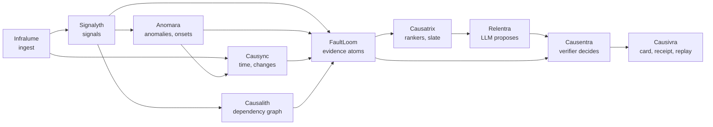

# Veyltrace

**Verifiable, change-aware root-cause analysis for microservice outages.**
Statistical rankers and a local LLM investigator *propose* hypotheses; a deterministic verifier *decides*; every verdict comes with a receipt that replays to the same hash.

> **Status (30 Oct 2026):** design complete, implementation starts Mon 2 Nov 2026. v1.0.0 is planned for Tue 1 Dec 2026 ([roadmap](docs/07-roadmap.md)). Nothing in this repo is a measured result yet; numbers in the docs are cited from published work or marked as targets.

## Why

Automated RCA is now sold by every major cloud and observability vendor, but nobody can audit those answers: published accuracy claims come without a method, and stricter public benchmarks put full, grounded diagnosis near 20% ([research report](reports/Veyltrace%20v2%20SOTA%20root%20cause%20analysis.md)). Veyltrace aims to be the open, laptop-runnable engine whose answers you can check:

- **Propose → verify.** AI (rankers, a local LLM) may suggest candidates and request checks. Only code-evaluated evidence moves the verdict, and every check the AI asks for is run on every candidate, so the AI cannot argue for a favourite.
- **Honest output.** A conformal candidate set with a coverage target, plus `CONFIRMED`, `LIKELY`, `INCONCLUSIVE` or `NO_FAULT`. When evidence is missing, it says what telemetry would settle it.
- **Change-aware.** Deploys, config and feature-flag changes are evidence, tested against planted decoy changes.
- **Replayable.** Hashes of inputs, config, code, model file and recorded LLM outputs go into an in-toto receipt; `veyltrace replay` re-runs the verdict and checks the hash.
- **Local.** Runs on a 16 GB laptop with CPU-only open-weight models; no telemetry leaves the machine by default.

## How it works



| Lane | Engines | Owner |
|---|---|---|
| Observe | Infralume, Signalyth, Anomara, Causync, Causalith | Annapurna S |
| Reason | FaultLoom, Causatrix, Causentra (+ contracts, core, bench) | Aniket Kumar (lead) |
| Explain | Relentra, Causivra (+ LLM adapter, API, console, fault lab) | C Lakshanaa |

Full design: [docs/02-architecture.md](docs/02-architecture.md). Contracts between engines: [docs/03-contracts.md](docs/03-contracts.md).

## Start here (team)

1. Read [AGENTS.md](AGENTS.md); your AI coding agent reads it too.
2. Follow the reading order in [docs/README.md](docs/README.md).
3. Set up your laptop and agent with [docs/09-ai-agent-playbook.md](docs/09-ai-agent-playbook.md).
4. Pick your issue from the project board; work in your lane only ([docs/08-collaboration-and-git.md](docs/08-collaboration-and-git.md)).

Commands below exist from milestone M0 (Tue 3 Nov 2026):

```bash
uv sync --all-packages
```

```bash
uv run veyltrace diagnose --dataset synth --case synth-01 --ai off
```

```bash
uv run veyltrace replay runs/synth/<case_id>/<run_id>/receipt.json
```

## Repository map

| Path | What |
|---|---|
| `docs/` | specs, plans, process, ADRs ([index](docs/README.md)) |
| `contracts/` | JSON Schemas and generated Python/TS models |
| `packages/` | the ten engines + `core`, `llm`, `gateway` |
| `bench/` | datasets, baselines, metrics, statistics, experiments |
| `lab/` | laptop fault-injection testbed and dataset capture |
| `console/` | web UI |
| `reports/`, `research_notes/` | research with sources |

## Licence and citation

Code: [Apache-2.0](LICENSE). Datasets we release: CC BY 4.0. If you use Veyltrace, cite it via [CITATION.cff](CITATION.cff).
