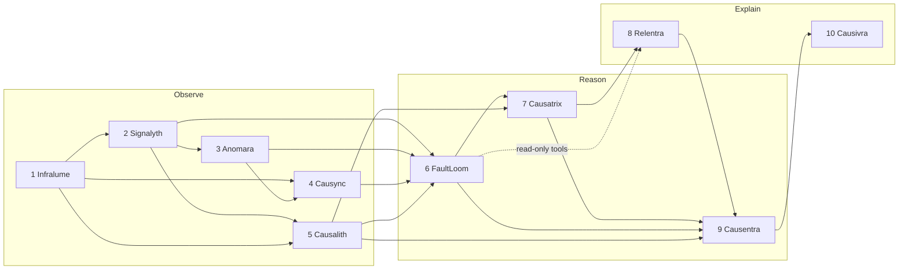

# 02 · Architecture (master spec)

> **Status:** v2.0-draft · **Owner:** Aniket Kumar (lead) · **Last updated:** 2026-10-30
> This file wins every disagreement between docs. If another doc contradicts it, fix the other doc (or open an ADR to change this one).
> Evidence for the design choices is in [the v2 research report](../reports/Veyltrace%20v2%20SOTA%20root%20cause%20analysis.md) and its [notes](../research_notes/Veyltrace%20v2%20SOTA%20root%20cause%20analysis/). Citations below use `[note §Q]`.

---

## 1. What Veyltrace v2 is, in one paragraph

Veyltrace diagnoses microservice outages. It reads metrics, logs, traces and change events for one incident window, and returns a **verdict**: the root-cause service (and component, indicator and fault class), a **calibrated candidate set** with a coverage guarantee, a confidence level that may be **"inconclusive"** or **"no fault"**, the evidence behind it, a plain-English incident card, and a **receipt** that lets anyone re-run the verdict and get the same hash. Statistical rankers and an LLM investigator **propose** hypotheses; a deterministic verifier **decides**. It runs on a 16 GB laptop with no cloud.

## 2. Design principles (binding)

| # | Principle | What it means in code | Why (evidence) |
|---|---|---|---|
| P1 | **AI proposes, code decides** | Only Causentra sets the verdict, using a fixed decision function. ML/LLM outputs enter only as *proposals* or as *evidence that code re-computed*. | Unverified LLM agents hallucinate root causes (the weakest model did so in 40% of ORCA-bench cases) and stop early; an explicit verification step (LLM-based in DiagGuard) lifted accuracy in all 14 tested configurations (+3.5–35 pp). No paper isolates a purely deterministic verifier; measuring that is part of our contribution `[sota_methods §2; verified_agents §Q2]` |
| P2 | **AI can buy evidence, never assert it** | An LLM claim counts only after code re-evaluates its predicate on stored data. Unverified claims have zero weight. A predicate the AI asks about is evaluated **for every candidate in the pool** (symmetric evaluation), so the AI can surface discriminating evidence but cannot advocate for its favourite. | DiagGuard's LLM verifier did not fix "semantics misread"; those checks must be code `[verified_agents §Q2]`; one planted false sentence made models pick a decoy first in 21–42% of cases `[benchmarks_and_testbed §Q2]` |
| P3 | **Replayable by construction** | Every engine is a pure function of declared inputs + config. LLM calls are recorded in a cassette; replay re-runs the verifier on recorded outputs and must reproduce `verdict_hash`. | Bit-exact LLM regeneration is not portable across machines `[verified_agents §Q3]` |
| P4 | **Abstain honestly** | The verdict can be `INCONCLUSIVE` or `NO_FAULT`. A candidate set, not a single guess, is the primary output. | All methods emit false root causes on normal periods (PetShop); our searches up to Oct 2026 found no RCA work using conformal candidate sets, though close work exists (LM-PACE calibrates RCA confidence; CROC and an OSDI'26 abstention paper were seen only as snippets) `[novel_building_blocks §Q7, §Q10]` |
| P5 | **Change-aware** | Deploys, config and feature-flag changes are a first-class evidence channel. | ~68% of Google outages in 2010–2017 postmortems were triggered by binary or config pushes `[novel_building_blocks §Q5]` |
| P6 | **Cheap and local** | Deterministic path runs in seconds per case on CPU. LLM path uses a local open-weight model by default; cloud models are an optional adapter. | BARO/N-Sigma run in 0.01 s/case while CIRCA/RUN take up to ~1–1.4 h on Train Ticket `[novel_building_blocks §Q4]` |
| P7 | **No ground-truth leakage** | Engines see an opaque `case_id`. Answer keys live only in `bench/` and `lab/`, and engines never read files under those folders (calibration reaches Causentra through `config/`). Fault-injection artefacts (chaos labels, `feature_flag.*` attributes) are scrubbed at ingest. | OTel Demo flag keys can appear in telemetry `[benchmarks_and_testbed §Q4]` |
| P8 | **Measure against honest floors** | Every result is reported next to chance, N-Sigma, BARO and an alert-count baseline, per system, with clustered statistics. | Simple alert counting matches SOTA on existing benchmarks; pooled leaderboards pick the wrong method on up to 5/11 subsystems `[benchmarks_and_testbed §Q1–Q2]` |

## 3. The ten engines

Each engine is one Python package, owned by one lane, with one job and one output contract. Names are fixed; roles were assigned for v2 (not inherited from the hack-day design).

| # | Engine | Job (one line) | Reads | Writes (contract) | Lane |
|---|---|---|---|---|---|
| 1 | **Infralume** | Ingest any source into one canonical telemetry store; scrub leakage | raw benchmark folders, lab captures, live OTLP | `case_manifest`, `telemetry.{metrics,logs,spans,events}` | Observe |
| 2 | **Signalyth** | Turn raw telemetry into typed signals: series, call edges, log templates, critical paths | telemetry | `signal_cube.{series,edges,templates,critical_path}` | Observe |
| 3 | **Anomara** | Score anomalies per series, estimate onsets and the incident onset, flag silent services | signal_cube, alert; `detect_alert()` reads telemetry | `anomalies`, `onsets` | Observe |
| 4 | **Causync** | Align clocks across sources; build the change timeline; score change–onset proximity and changed-vs-peer contrast | telemetry.{events,spans,logs}, signal_cube, anomalies, onsets | `alignment`, `changes` | Observe |
| 5 | **Causalith** | Build the dependency graph (traces + topology + log mentions) and compute propagation paths for anomalous services | telemetry.{spans,logs,events}, signal_cube, anomalies | `graph.{nodes,edges,paths}` | Observe |
| 6 | **FaultLoom** | Weave all observations into per-candidate **evidence atoms** with stable IDs and provenance | signal_cube, anomalies, onsets, alignment, changes, graph | `evidence` | Reason |
| 7 | **Causatrix** | Run several deterministic rankers, fuse them, classify fault mode; output the hypothesis slate | evidence, graph | `slate` | Reason |
| 8 | **Relentra** | LLM investigator: probes the slate with read-only tools, **proposes** extra candidates, claims and trials | slate, evidence (via tools), system brief | `proposals`, `agent_trace` | Explain |
| 9 | **Causentra** | Deterministic verifier: runs trials, re-checks claims, applies the decision function, conformal set, abstention | slate, evidence, graph, proposals, calibration | `verdict` | Reason |
| 10 | **Causivra** | Writes the incident card under a claim checker; assembles the receipt; implements replay | verdict, evidence, onsets, changes, graph, agent_trace, run_manifest | `card`, `receipt` | Explain |

Non-engine components:

| Component | Job | Lane |
|---|---|---|
| `contracts/` | JSON Schemas (source of truth) + generated Python/TS models | Reason (lead) |
| `packages/core` (`veyltrace_core`) | canonical JSON, hashing, IDs, config, pipeline runner and its **alert step** (writes `alert`), CLI, synthetic case generator, test helpers | Reason (lead) |
| `packages/llm` (`veyltrace_llm`) | LLM provider adapters (Ollama / llama.cpp / OpenAI-compatible), JSON-schema-constrained calls, cassette record/replay | Explain |
| `packages/gateway` | FastAPI HTTP API, live OTLP receiver hosting, MCP server | Explain |
| `console/` | React + TypeScript UI | Explain |
| `bench/` | dataset loaders, baselines, metrics, statistics, experiment runner, result tables | Reason |
| `lab/` | laptop testbed (Online Boutique, OTel Demo), fault catalog, load, capture packager, answer keys | Explain |

### 3.1 Why these boundaries

- **Observe (1–5)** turns bytes into facts. Nothing here ranks services. Every output is a table of observations.
- **Reason (6, 7, 9)** turns facts into a decision. FaultLoom is the only place evidence is created for the decision; Causatrix ranks; Causentra decides. Keeping evidence creation in one engine is what makes P2 enforceable: a claim from Relentra is valid only if FaultLoom's evidence functions can re-compute it.
- **Explain (8, 10)** holds every LLM call in the system. If the LLM is switched off (`--ai off`), engines 8 and 10 degrade to "no proposals" and "template card"; the verdict path still works.

## 4. Pipeline and data flow



Order of execution for one case (the runner in `veyltrace_core.pipeline` enforces it):

0. **Infralume** → `case_manifest`, `telemetry.*` (full available time span, no windows yet)
1. **Alert step** (core) → `alert` (protocol, `t_alert`, windows; §5.1). Under the detected protocol, core calls Anomara's `detect_alert(telemetry)` function, which reads entry-service spans/metrics directly from `telemetry.*`.
2. **Signalyth** → `signal_cube.*`
3. **Anomara** → `anomalies`, `onsets`
4. **Causync** and **Causalith** (independent; may run in parallel) → `alignment`, `changes`, `graph.*`
5. **FaultLoom** → `evidence`
6. **Causatrix** → `slate`
7. **Relentra** (skipped when `ai.mode = off`) → `proposals`, `agent_trace`
8. **FaultLoom (claim pass)** always runs (with `ai.mode = off` the pool is just the slate). It evaluates every predicate Relentra cited **for every candidate in the claim-pass pool** (slate ∪ every proposed candidate) and appends the results to `evidence` as atoms with `origin = "claim_check"`. It also writes `intervention` atoms (`origin = "engine"`, via Causalith's restricted test) for the first 5 decision-pool candidates in `slate.all_scores` order, for trial T8.
9. **Causentra** → `verdict`
10. **Causivra** → `card`, `receipt`

Step 8 is the mechanism behind P2: the LLM decides *which* checks are worth running; FaultLoom's code runs them symmetrically across candidates; only their results, weighted by fixed per-predicate weights, can move the verdict.

Two pools, named so they are never confused: the **claim-pass pool** (slate ∪ all proposed candidates; step 8) and the **decision pool** (slate ∪ proposed candidates whose own claims hold; §6.9 step 1).

### 4.1 Run directory

Every run writes to `runs/<dataset>/<case_id>/<run_id>/` (git-ignored):

```
case_manifest.json
telemetry/{metrics,logs,spans,events}.parquet
alert.json
signal_cube/{series,edges,templates,critical_path}.parquet
anomalies.parquet  onsets.json
alignment.json  changes.parquet
graph/{nodes,edges,paths}.parquet
evidence.parquet
slate.json
proposals.json  agent_trace.jsonl  cassette/        (AI on only)
verdict.json
card.json  card.md
config.lock.json  run_manifest.json  receipt.json  [receipt.json.minisig]
```

`run_id` = first 16 hex chars of SHA-256 over (`case_id`, config hash, code commit, `ai.mode`). It is not a timestamp (P3). The config hash covers LLM seeds and sampler settings, so a different seed is a different run. Re-running `ai.mode = record` on an existing `run_id` refuses to overwrite unless `--force-record` is given. Each run dir also holds `config.lock.json`, the fully resolved config, so replay does not depend on the repo's current `config/` files. An MCP `verify_hypothesis` call on an existing run creates a derived run dir `<run_id>-x<first 12 hex of SHA-256 of the canonical external proposal>` that reuses the parent's step 0–7 outputs by hash and re-runs steps 8–10.

## 5. Execution modes

| Mode | Input | Trigger | Used for |
|---|---|---|---|
| **Offline case** | one benchmark case folder or lab capture | CLI `veyltrace diagnose --dataset re2-ob --case <id>` | all experiments |
| **Batch** | a whole dataset | `veyltrace bench run <experiment.yaml>` | paper tables |
| **Live** | OTLP stream from the lab cluster | gateway's alert watcher (SLO breach on entry service) or "Diagnose now" button | demo |
| **Replay** | a `receipt.json` | `veyltrace replay <receipt.json>` | audit, CI |

Live mode is offline mode on a snapshot: when triggered, the gateway freezes the last *W* minutes of the in-memory buffer to Parquet (with hashes) and runs the same pipeline. There is one code path for analysis (`veyltrace_core.pipeline.run_case`), so every live verdict is replayable.

### 5.1 Alert time and windows

Engines never see the fault-injection time. They receive `t_alert` from `alert.json`, written by core's alert step (pipeline step 1):

- **Oracle-alert protocol:** the adapter passes `case_manifest.t_alert_hint_ns` = the dataset's published injection time; core copies it to `t_alert`. This is the standard RCAEval protocol, kept for comparability with the literature. The hint is the only place the injection time crosses into engine-visible data, and it is never stored under that name.
- **Detected-alert protocol:** core calls Anomara's `detect_alert(telemetry)`: the first sustained SLO breach (latency p99 or error rate) on the entry service(s), computed from `telemetry.*` plus the descriptive fields of `case_manifest` (system, services, data span), never `t_alert_hint_ns`. Realistic; reported next to oracle.
- **Live:** the gateway's watcher or the "Diagnose now" click time is the hint.
- **Onset shift** (`alert.shift_s`, robustness only) adds a fixed offset to `t_alert`. It is a mandatory test because, in one 2026 preprint, a 2-minute shift dropped N-Sigma from 0.80 to 0.07 AC@1 on RE2 `[benchmarks_and_testbed §Q2]`.

`alert.protocol` and `alert.shift_s` are keys in `config/core.yaml` (experiment YAMLs override them). Windows (defaults, also in `config/core.yaml`): baseline `[t_alert − 20 min, t_alert − 2 min]`, incident `[t_alert − 2 min, t_alert + 8 min]`, each clamped to available data (RCAEval cases have only ~10–12 min before injection, so their baseline is shorter; the clamped bounds are what `alert.json` records). Anomara refines the *incident onset* `t_onset` inside the incident window; scoring windows downstream are anchored at `t_onset`.

### 5.2 AI modes

| `ai.mode` | Relentra | Causivra prose | Verdict depends on LLM? |
|---|---|---|---|
| `off` | skipped | template only | no |
| `record` | runs; every call written to `cassette/` | LLM + claim checker, template fallback | only through code-verified claims (P2) |
| `replay` | reads `cassette/`; fails on any unrecorded call | from cassette | same as `record`, bit-identical `verdict_hash` |

## 6. How each engine works (summary)

Full specs are in [docs/engines/](engines/). This section fixes the algorithms and the choices behind them.

### 6.1 Infralume — ingest

- **Adapters** (one module each, auto-discovered by entry point `veyltrace.adapters`): `rcaeval` (RE1/RE2/RE3), `nezha`, `fse26_tt` (FSE'26 TrainTicket set; format to verify), `veyllab` (our lab captures), `otlp_live` (snapshot from the gateway buffer).
- **Canonical tables:** long-format Parquet with fixed column names (see [03-contracts](03-contracts.md)). Times are int64 nanoseconds since epoch, UTC.
- **Leakage scrubbing (P7):** drop attribute **keys** matching a deny-list (`feature_flag.*`, `chaos*`, `fault*`, `inject*`), drop the telemetry of the flagd service and of Chaos Mesh components, and replace the folder name with `case_id = sha256(case name)[:12]`. Flag-change *events* are kept (they are real change evidence) with flag keys hashed. A unit test checks every output for deny-listed attribute keys, original folder-name tokens and dropped services (not a free-text grep, since words like "fault" occur in legitimate log lines).
- **Dataset fetchers** (`veyltrace data fetch <dataset>`) live in `veyltrace_infralume.fetch`, registered under the entry-point group `veyltrace.fetchers`. They are the only engine code allowed to use the network (stdlib `urllib` only) and are never imported by `api.py`; the isolation test enforces both.
- **Synthetic cases:** `veyltrace_core.synth` registers an adapter `synth` (dataset `synth`) that writes canonical tables and `case_manifest` directly.
- **Sources-present map:** `case_manifest.sources` records which of metrics/logs/traces/events exist; downstream engines must handle any subset (missing telemetry is a tested condition, §9).

### 6.2 Signalyth — signals

- **Metrics:** counters → per-second rates; unit normalisation; per-(service, component, signal) series on a 1 s or native grid (no resampling below native step).
- **Logs:** Drain3 template mining, one fresh miner per service in A→Z order, messages sorted (count desc, text asc) for determinism; per-template counts and error-level rates per 10 s bucket. (LLM template refinement is an **ablation arm only**, `[novel_building_blocks §Q2]`.)
- **Traces:** per-service latency p50/p99, error rate, request rate, **self-time** (duration minus children); per-edge caller/callee latency and gap; **critical-path contribution** per span (CRISP-style longest-path over the span tree) `[novel_building_blocks §Q3]`.
- **Klass tags:** each series is tagged `internal` (resource, self-time, own logs), `external` (caller-visible latency/errors) or `context` (traffic). PRISM's internal-vs-external split drives FaultLoom.

### 6.3 Anomara — anomalies and onsets

- **Detectors** (all deterministic, CPU): robust z on baseline (median/MAD with a multi-part scale floor — MAD, IQR/1.349, per-family epsilon, 2% of |median|), N-Sigma, BARO-style Bayesian online change-point for onset. Per series it writes the max score, direction, onset time and `above_threshold` flag.
- **Silence detector:** a series that drops to zero or disappears is an anomaly (`detector = silence`), never "healthy" `[verified_agents §Q2]`.
- **Incident onset:** `t_onset` = second-earliest external-klass onset among services (robust to one noisy early series), clamped to `[t_alert − 60 s, t_alert + 300 s]`.
- **Optional plugin:** time-series foundation-model residual scorer (Chronos-Bolt-tiny / Toto, Apache-2.0) — **off by default**, ablation only; zero-shot TSFMs scored ≈ classical detectors on TSB-AD-U (0.319 vs 0.332–0.353 VUS-PR) `[novel_building_blocks §Q1]`.

### 6.4 Causync — time and change

- **Clock alignment:** estimate per-source skew from trace parent/child pairs and log/metric co-movement; publish offsets in `alignment`. Downstream onset comparisons use aligned times and a tolerance equal to the coarsest source step (metrics are often 15 s scrapes).
- **Change timeline:** from `telemetry.events` (k8s rollouts, config/flag changes, image tags, commits). Each change gets `entity`, `kind`, `t`, `scope`.
- **Change evidence:** ASOF-join the latest change before each candidate's onset; proximity score `exp(−Δt / τ_change)`; **changed-vs-peer contrast** where replicas exist (Meta compares changed hosts with unchanged ones in its health checks; its fleet-wide false-positive rate fell from 12.1% to 2.7% over a year, though the note does not attribute the drop to that idea alone) `[novel_building_blocks §Q5]`.
- **Decoys:** Causync treats every change the same; decoy changes are injected by `bench` (RCAEval-C extension) to test that the channel is not gullible.

### 6.5 Causalith — dependency graph

- **Edges** from: traces (observed calls; weight = call count, latency share), topology hints (k8s service/deployment metadata in events), log mentions (`host:port`, URLs, gRPC packages). Each edge records its provenance set.
- **No full causal discovery.** On 10–50-node graphs, discovery F1 is 0.1–0.54 and PC/FCI ran out of memory at 50 nodes; most graph-learning RCA scores ≈ random `[novel_building_blocks §Q4]`. Causalith uses the observed call graph, and offers a **restricted conditional-independence test** on ≤ 5 candidate neighbourhoods for Causentra's intervention trial.
- **Paths:** Causalith runs before the slate exists, so it computes paths for **every service with an anomaly** (any klass): shortest anomalous propagation paths to the entry service(s). Later engines look up the paths of their candidates.

### 6.6 FaultLoom — evidence fabric

- One row per **evidence atom**: `atom_id`, `candidate` (service[/component]), `kind` (closed list in [03-contracts §7](03-contracts.md), e.g. `internal_anomaly`, `external_anomaly`, `onset_precedence`, `change_proximity`, `spectrum`, `critical_path_share`, `log_new_template`, `silence`, `claim_check`), numeric `value`, `unit`, `window`, `refs` (hashes of source rows), `origin` (`engine` or `claim_check`).
- `atom_id` = `E` + first 10 hex of SHA-256 over (kind, candidate, canonical args). Same inputs → same IDs, so Causivra can cite atoms and replay can match them.
- **Predicate library:** every claim type Relentra may make is a named predicate here (`zscore_above`, `onset_before`, `edge_anomalous`, `self_time_share_above`, `change_before_onset`, `template_new_in_incident`, …) with a fixed signature, a fixed **polarity** (supports / refutes the candidate being the root) and a fixed **weight** (config, a priori). The **claim pass** (pipeline step 8) evaluates only predicates in this library, substituting each pool candidate for the subject argument; anything else is rejected as `unknown_predicate`.

### 6.7 Causatrix — hypothesis slate

Rankers (each a pure function over evidence/graph; each also reported alone as a baseline or ablation):

| Ranker | Idea | Source |
|---|---|---|
| `prism_m` | M = I + E − log(1 + I + E) over internal (I) and external (E) evidence | PRISM 2026 |
| `baro_rs` | max robust-scaled deviation per service | BARO (FSE'24) |
| `nsigma` | max N-sigma deviation per service | RCAEval baseline |
| `cp_sbfl` | Ochiai spectrum over traces, weighted by critical-path share | Ochiai/TraceRCA + CRISP, new combination |
| `change_prox` | change-proximity × anomaly presence | Causync channel |
| `graph_walk` | personalised PageRank that walks from symptoms toward dependencies (caller → callee, i.e. against the propagation direction), personalised by anomaly scores | MicroRank family |

- **Fusion:** gated reciprocal rank fusion (RRF, k = 60): a ranker votes only if its channel exists for the case (no traces → `cp_sbfl` abstains). Weights are fixed a priori (all 1.0); the fusion rule is an ablation, never tuned on test data.
- **Mode and fault class:** a rule table maps evidence pattern → mode (`resource`, `network`, `code`, `change`, `dependency`) → fault class (`cpu`, `mem`, `disk`, `delay`, `loss`, `error`, `config`, …). Indicator = the candidate's top-scoring signal family.
- **Slate:** top-K (default 5) candidates with per-ranker ranks, fused score, mode, indicator. `bench` reports **Retrieval@K** (truth in slate) separately from final accuracy, following the NeurIPS'26 retrieval/rerank decomposition `[sota_methods §1]`.

### 6.8 Relentra — the investigator (proposes)

- **Shape:** a code-owned state machine, not a free-running agent. Small local models loop and fail to act on earlier results, so code enforces: *pick hypothesis → run ≤ N checks → emit proposal* `[verified_agents §Q1]`.
- **Two modes:**
  - `brief` (**default**): one or two LLM calls over compact, code-computed **evidence cards** for the slate (top atoms per candidate, timeline, path). Output: proposals and predicate requests. Evidence-card prompting matched or beat tool-heavy agents at 15–26× fewer tokens (EviRCA), and one listwise LLM pass added 7–18 points over a deterministic shortlist (DecompRCA) `[sota_methods §3]`. Fits a CPU laptop.
  - `investigate`: the multi-turn tool loop below. Used as an ablation arm and on machines with a GPU or a remote endpoint.
- **Tools (read-only, compact outputs):** `compare_windows(entity, signal)`, `neighbors(entity)`, `timeline(entity)`, `top_templates(entity)`, `trace_paths(entity)`, `evidence(atom_id)`, `sql(query)` over allow-listed DuckDB views with a row limit. Tool outputs are code-computed summaries, never raw dumps (token budget is the binding laptop constraint).
- **Output (JSON-schema constrained):** `Proposal{hypothesis{service ∈ enum(graph nodes), fault_class ∈ enum(taxonomy), indicator}, claims[{predicate ∈ enum(library), args (excluding the subject), cites: [atom_id | tc:<seq>]}], requested_trials[], asks[]}` (exact fields: [03 §9.1](03-contracts.md)). Closed enums make out-of-schema causes impossible to express `[verified_agents §Q2]`.
- **Budget (defaults):** ≤ 5 hypotheses, ≤ 12 LLM turns, ≤ 16 K context, ≤ 180 s wall time on CPU. On budget exhaustion it emits what it has.
- **Model:** default local Qwen3.5-9B Q4 via Ollama or llama.cpp; fallback Qwen3.5-4B for CPU-only laptops; any OpenAI-compatible endpoint as an option. Scores quoted for these models are vendor-reported; each laptop runs `llama-bench` at M0 and the exact GGUF SHA-256 is pinned in config `[verified_agents §Q4]`.
- **Recording:** every call → cassette entry keyed by SHA-256 of the canonicalised request; `agent_trace.jsonl` is a hash chain (`line_hash = sha256(prev_hash ‖ canonical_json(line))`).

### 6.9 Causentra — the verifier (decides)

**Trials** (deterministic predicates over evidence + graph; each returns `pass | fail | untestable(reason)`):

| ID | Trial | Mandatory | Catches |
|---|---|---|---|
| T1 | **Origin:** candidate has internal-klass anomaly not explained by its callees | yes | victim mistaken for culprit |
| T2 | **Precedence:** candidate onset ≤ dependents' onsets (aligned, with tolerance) | yes | late symptom |
| T3 | **Propagation:** anomalous services upstream of the candidate are reachable from it in the graph | yes | untested edge |
| T4 | **Silence check:** candidate is not "healthy because silent" | yes | silence-as-health |
| T5 | **Latency accounting:** candidate's self-time increase explains ≥ 30% of the entry-service latency increase | no (trace cases) | wrong layer |
| T6 | **Change alignment:** a change on the candidate precedes onset within τ | no (supporting) | change-induced faults |
| T7 | **Peer contrast:** affected replica differs from healthy peers | no | node-local faults |
| T8 | **Intervention:** candidate's anomaly is not explained by its parents (restricted CI test, IDI-style) | no | confounded symptoms |
| T9 | **Leave-one-source-out:** candidate stays in top-K when each telemetry source is dropped | no | single-channel artefacts |
| T10 | **Claim checks:** every Relentra claim about this candidate re-evaluates to true | yes, for proposal-origin candidates only (a false claim never lowers a slate candidate) | hallucinated support |

**Decision function** (fixed; parameters are config, set a priori, never tuned on test splits):

1. **Decision pool** = slate ∪ proposed candidates (that exist in `graph.nodes`) with at least one supporting claim that holds. T10 is then applied to them as a mandatory trial: if any of their claims is false, T10 fails.
2. Base score `S0(c)` = fused score from `slate.all_scores` (which covers every service, so proposed candidates outside the top-K have one), divided by the decision-pool maximum (so 0–1).
3. Verified score `V(c) = S0(c) × Π trial_factor(c) × (1 + clip(Σ_p w_p · polarity_p · holds_p(c), −0.3, +0.3))`, where:
   - trial factors: pass = 1.0; mandatory trial untestable = 0.85, failed = 0.25; supporting trial untestable = 1.0, failed = 0.9 (a missing supporting check must never cost more than a failed one);
   - the sum runs over predicates `p` evaluated in the claim pass; `holds_p(c)` is that predicate's code result **for candidate c** (symmetric evaluation, P2); `w_p` and `polarity_p` are fixed in the predicate library (default `w_p = 0.1`).
   With `ai.mode = off` the sum is empty, so AI-on vs AI-off differences are fully attributable to code-verified evidence the AI chose to request.
4. **Conformal set:** nonconformity `s(c) = 1 − V(c) / max V` over the decision pool. Calibration: on each calibration case, score the **true root**: `s(root)` if the root is in the decision pool, else `+∞`. With n calibration scores, `q̂` = the ⌈(n + 1)(1 − α)⌉-th smallest (α = 0.10; `+∞` if that index exceeds n). Output every decision-pool candidate with `s(c) ≤ q̂` `[novel_building_blocks §Q7]`. Services outside the decision pool are never in the set, so decision-pool retrieval (`pool_hit`; equal to Retrieval@K when AI is off) bounds coverage and is reported next to it; coverage is always measured on held-out cases, never on the calibration split.
5. **Status** (first rule that matches; `margin = (V_top − V_runner-up) / V_top`, 1.0 if there is no runner-up):
   - `NO_FAULT` — no service is silent (Anomara `silence` detector) and `M ≤ τ_nf`, where `M` = max of the entry service's external `score_norm` and every internal `score_norm`, using the `robust_z` detector. `τ_nf` is the (1 − β)-quantile of `M` over **normal windows** (β = 0.10), so at most ~10% of normal windows are expected to be flagged as faults. Normal windows come from `synth-05`, VeylLab no-fault captures and RCAEval pre-injection segments (alert placed before injection, windows clamped). The candidate set is empty.
   - `CONFIRMED` — set size 1, all mandatory trials pass, margin ≥ c_high (0.30).
   - `LIKELY` — top candidate passes all mandatory trials, set size ≤ 3, margin ≥ c_med (0.15).
   - `INCONCLUSIVE` — anything else; the verdict lists `asks` (the missing telemetry or trial that would settle it).
   `confidence.level`: CONFIRMED → `high`, LIKELY → `medium`, INCONCLUSIVE with a leader → `low`, otherwise `none`.
6. Ties break on: −round(V, 9), internal-first, earliest aligned onset, service name A→Z.

`verdict_hash` = SHA-256 of the canonical verdict JSON (excluding the hash field). Calibration (`q̂`, `τ_nf`, the split it was fitted on) is fitted by `bench` only on calibration splits defined in [04-evaluation-protocol](04-evaluation-protocol.md) and written to `config/calibration/<family_id>.json`, where `family_id` encodes benchmark family, AI arm, alert protocol and fold ([03 §12.1](03-contracts.md)). Causentra reads it through `ctx.config` like any other config; its hash goes into the run manifest. Engines never read `bench/`. Without a calibration file (early milestones, live demo before calibration), Causentra uses `q̂ = 0` (set = top candidate only) and `τ_nf = log1p(3)`, writes `calibration.family = "uncalibrated"`, and such runs are never used for coverage results.

### 6.10 Causivra — explanation and receipt

- **Card:** title, status, root cause, candidate set, confidence, timeline, propagation path, evidence table, why-not for runner-ups, asks, next steps (deterministic playbook per fault class).
- **Prose under a claim checker:** the LLM writes sentences with placeholders (`{E3f…a1.value}`, `{ROOT}`); code fills numbers and names. The checker rejects any sentence with a raw number, an entity outside the enum, or no atom citation. Two failures → template prose. Numeric hallucination is impossible by construction.
- **Receipt:** `receipt.json` = run manifest (input hashes, config hash, code commit, `uv.lock` hash, model GGUF SHA-256, prompt and schema hashes, calibration hash) + `agent_trace` head hash + `verdict_hash`, wrapped as an in-toto Statement (`predicateType: https://veyltrace.dev/rca-verdict/v1`). Optional local signing (minisign) for the demo `[verified_agents §Q7]`.
- **Replay** (`veyltrace replay <receipt>`): by default, re-hash the stored outputs of steps 0–4, `config.lock.json`, the calibration file and the cassette; then re-run steps 5–10 and compare hashes. `--full` re-hashes the raw inputs and re-runs steps 0–10. Exit codes: 0 ok, 1 error, 2 verdict hash or agent-trace head mismatch, 3 inputs missing/changed, 4 invalid config, 5 environment drift (Python major.minor, library versions or `uv.lock` differ; OS is reported but not compared), 6 narrative mismatch only.
- **End-of-run order:** 10a Causivra writes `card` → core writes `config.lock.json` and `run_manifest.json` (which lists every artifact except itself and the receipt) → 10b Causivra writes `receipt`. Engines that call an LLM (Relentra, Causivra) report their prompt, schema and cassette hashes to core through an `ai_manifest` field on `EngineResult`; core copies them into `run_manifest.ai`.

## 7. Contracts (overview)

Contract = a versioned JSON Schema in `contracts/schemas/` + generated Pydantic (Python) and TypeScript types in `contracts/generated/`. Tables (Parquet) are described by JSON Schema too (one object = one row). Full field lists: [03-contracts](03-contracts.md).

Rules:
1. Producer lane owns the semantics; the **lead owns the file**. Changes go through a Contract Change Request issue + ADR (see [08-collaboration-and-git §5](08-collaboration-and-git.md)).
2. `v0.x` until milestone **M1**; frozen at `v1.0` on M1; after that only additive optional fields (minor bump) without all-lane sign-off.
3. Every producer ships **golden fixtures** (synthetic case `synth-01…05`) for its outputs in `packages/<engine>/fixtures/`. Consumers build and test against those, so no lane waits for another.

## 8. Technology stack (pinned at M0, recorded in ADRs)

| Concern | Choice | Notes |
|---|---|---|
| Language | Python 3.12 (engines, API, bench); TypeScript 5 (console) | RCAEval's harness needs 3.12 |
| Packaging | **uv workspace** (one root `uv.lock`); **pnpm** for console | lockfiles regenerated, never hand-merged |
| Data | Parquet (zstd) as the durable format; **DuckDB** (2.0.x LTS, Parquet-only so file-format changes don't matter); pyarrow, numpy, scipy | ASOF JOIN for change-before-onset |
| Logs | Drain3 | deterministic order rules (§6.2) |
| Graph | networkx | small graphs (≤ 100 nodes) |
| Models | Pydantic v2 generated from JSON Schema (datamodel-code-generator); TS via json-schema-to-typescript / openapi-typescript | CI fails on drift |
| LLM runtime | llama.cpp `llama-server` (`-np 1`, `cache_prompt: false`, fixed seed) or Ollama (`OLLAMA_NUM_PARALLEL=1`, fixed `seed`, `temperature` per config); JSON-schema constrained decoding. Regeneration tests use llama.cpp; Ollama is the easy default for development | cassette replay is the guarantee |
| API | FastAPI; MCP server (official Python SDK) | MCP lets other agents call `verify_hypothesis` |
| UI | React + Vite + TypeScript, ECharts (time series), Cytoscape.js (graph) | |
| Lab | Docker Desktop + WSL2 (raise to 11–12 GB), Online Boutique on kind, OTel Demo 3.x on Compose, Chaos Mesh, OTel Collector contrib with `memory_limiter` | Train Ticket does not fit 16 GB |
| Quality | ruff, pyright, pytest + hypothesis, eslint, prettier, vitest, pre-commit, towncrier, Conventional Commits | |
| CI | GitHub Actions, `ubuntu-latest` only (public repo → free minutes) | |

## 9. Cross-cutting rules

**Determinism (engines 1–7, 9, and the deterministic parts of 10):**
1. No wall-clock reads in analysis code; times come from data or config.
2. Randomness only via `veyltrace_core.rng(case_id, purpose)`.
3. Every output sorted by its declared key before writing; floats written as-is in Parquet, rounded to 9 decimals in JSON via `canonical_json`.
4. `canonical_json`: sorted keys, no whitespace, UTF-8, NaN/Inf → null.
5. CI determinism gate: run the pipeline twice on `synth-01` and one small real case; all output hashes must match.

**Network and AI isolation:**
1. Engines 1–7 and 9 must not import `veyltrace_llm`, any LLM/HTTP client, `torch`/`transformers` (except Anomara's optional TSFM plugin, imported lazily and off by default), or `socket`-level networking. The one exemption is `veyltrace_infralume.fetch` (dataset download, stdlib `urllib` only, never imported by `api.py`). A CI test (`tests/test_isolation.py`) imports each engine in a fresh interpreter and checks `sys.modules` against a deny-list, plus an AST scan for banned imports.
2. Only `relentra`, `causivra` and `gateway` may import `veyltrace_llm`. By default `veyltrace_llm` talks to `localhost` only; remote endpoints need `VEYLTRACE_ALLOW_REMOTE_LLM=1`.
3. No engine reads files under `bench/` or `lab/` (answer keys live there). The isolation test scans engine source for those path literals; calibration reaches Causentra via `config/calibration/`.

**Missing telemetry:** every engine accepts any subset of sources. Missing channels make rankers abstain and trials `untestable`, which pushes the verdict toward `INCONCLUSIVE` with an `ask`. This is evaluated by the telemetry-ablation protocol (drop metrics / logs / traces / events per case).

**Performance budget (16 GB laptop, deterministic path):** ≤ 30 s and ≤ 3 GB RAM per RCAEval RE2 case, excluding first-time Parquet conversion. AI path adds ≤ 180 s for Relentra plus ≤ 60 s for Causivra's narration on CPU (*targets*; measured at M0 with `llama-bench`).

## 10. Deployment shapes

| Shape | What runs | Who |
|---|---|---|
| Dev laptop | CLI + DuckDB + optional Ollama | everyone |
| Demo laptop | lab cluster (Online Boutique) + collector + gateway + console: ≈ 5–8.5 GB inside WSL2 (*estimate*). Adding a 9B model (≈ 6–7 GB) likely exceeds 16 GB, so the single-laptop demo runs with `--ai off` or the 4B model; the OTel Demo and Online Boutique are never run together | Explain lane |
| Split demo | lab + engines on laptop A; Ollama on laptop B over LAN (`VEYLTRACE_ALLOW_REMOTE_LLM=1`) | fallback if RAM is tight |
| Cassette demo | lab + engines live; LLM steps replayed from a cassette recorded earlier on a stronger machine (`ai.mode = replay`) | safest fallback; the receipt states it |
| Cloud (later) | same containers on one VM; Bedrock/OpenAI-compatible adapter | post-v1.0 |

## 11. Out of scope for v1.0 (do not build)

- Automatic remediation or any write action on the cluster.
- A chat interface over raw logs.
- GNN trace models, full causal discovery over all series, LLM-prior causal discovery `[novel_building_blocks §Q10]`.
- LLM-as-judge anywhere in the decision path.
- Multi-tenant auth, RBAC, hosted SaaS.
- Training or fine-tuning LLMs (a fine-tuned small verifier is a post-v1.0 research idea).

## 12. Open decisions (tracked as ADRs)

| Question | Decide by | Default if undecided |
|---|---|---|
| DuckDB 2.0.x vs 1.5.x pin | M0 smoke test | 2.0.x LTS |
| Default local model per laptop | M0 `llama-bench` | Qwen3.5-9B Q4_K_M, else 4B |
| FSE'26 TrainTicket set usable (size/format/licence)? | M1 | drop to "stretch" |
| Calibration family split (per system vs pooled) | M2 | per benchmark family, LOSO reported |
| Lab dataset target size | M2 | ≥ 120 validated cases |
