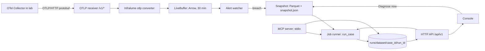

# 06 · Gateway, MCP server and console

> Status: v0.1-draft · Lane: Explain · Master: [02 §3](02-architecture.md#3-the-ten-engines) (non-engine components), [§5](02-architecture.md#5-execution-modes) (live mode), [§8](02-architecture.md#8-technology-stack-pinned-at-m0-recorded-in-adrs) (API, UI rows), [§9](02-architecture.md#9-cross-cutting-rules), [§10](02-architecture.md#10-deployment-shapes) (demo shapes), [§11](02-architecture.md#11-out-of-scope-for-v10-do-not-build) · Contracts: [03](03-contracts.md) §2.1, §2.6, §3, §6–12, §14 · Roadmap: X-00, X-04, X-05, X-10, X-12, X-13 · Last updated: 2026-10-30

---

## 1. Purpose and scope

| Component | Package | Job |
|---|---|---|
| Gateway | `packages/gateway` (`veyltrace_gateway`) | FastAPI HTTP API over run directories; a job runner that calls `veyltrace_core.pipeline.run_case`; the live OTLP receiver, buffer, snapshot and alert watcher; the MCP server |
| Console | `console/` | React + TypeScript UI over the gateway API |

The gateway holds **no analysis logic**. Every verdict, live ones included, comes from `run_case` on files written to disk, so every verdict is replayable ([02 §5](02-architecture.md#5-execution-modes)). The gateway never writes to the cluster, and v1.0 has no authentication (multi-tenant auth is out of scope, [02 §11](02-architecture.md#11-out-of-scope-for-v10-do-not-build)); both facts are why it binds to loopback by default (§3.6).

## 2. Runtime model

- One Python process: `uv run python -m veyltrace_gateway` (the `veyltrace` CLI belongs to core; the gateway ships its own module entry). Two listeners: the API (`api.host:api.port`, default `127.0.0.1:8000`) and the OTLP receiver (`live.otlp_host:live.otlp_port`, default `127.0.0.1:4319`, enabled only with `live.enabled`). The MCP server runs as a separate stdio process (`python -m veyltrace_gateway.mcp`) that uses the same service layer.
- **Job runner:** one worker thread and a FIFO queue (`jobs.workers = 1`), because each run may use up to 3 GB RAM ([02 §9](02-architecture.md#9-cross-cutting-rules)) and the LLM runtime has one slot. `run_id` is computed before the run from (`case_id`, config hash, code commit, `ai.mode`) ([02 §4.1](02-architecture.md#41-run-directory)), so `POST /runs` is idempotent.
- Run directories are the only state. Restarting the gateway loses only queued jobs and the live buffer.

## 3. HTTP API

### 3.1 Conventions

- Base path `/api/v1`; JSON; artifact responses are the **contract objects unchanged**, typed with the generated Pydantic models from `veyltrace_contracts`. The gateway never adds or renames fields of a contract.
- Gateway-only envelopes (job status, lists, errors, replay report) are the API types of [03 §14](03-contracts.md#14-api-types-gateway): Pydantic models in `veyltrace_gateway.api_models`, exported through `packages/gateway/openapi.json` (§3.5). They never redefine a run artifact.
- Path parameters are validated before touching the filesystem: `dataset` ∈ known datasets, `case_id` = 12 hex, `run_id` = 16 hex; anything else → 404 (no path traversal).
- Errors: `{"error": {"code": str, "message": str}}` with HTTP 400/404/409/413/422/503.

### 3.2 Routes

| Method | Path | Request | Response (contract or envelope) | Notes |
|---|---|---|---|---|
| GET | `/api/v1/health` | — | `health` (envelope) | `{status: ok \| degraded, version, code_commit, ai: {default_mode, provider, model, reachable}, live: {enabled, receiving}}`; `reachable` from a cheap provider probe in `veyltrace_llm` |
| GET | `/api/v1/datasets` | — | `[dataset_summary]` | dataset id, case count |
| GET | `/api/v1/cases?dataset=&limit=&offset=` | — | page of `case_summary` | `case_id`, `dataset`, `system`, `sources`, `runs: [run_id]`; never answer keys or hints |
| GET | `/api/v1/cases/{dataset}/{case_id}` | — | `case_manifest` (03 §2.1) | the console does not display `t_alert_hint_ns` |
| POST | `/api/v1/runs` | `run_request` `{dataset, case_id, ai_mode: off \| record \| replay}` | 202 `run_status`; 200 if a finished run with that `run_id` exists | 409 when `ai_mode = replay` and the run has no cassette |
| GET | `/api/v1/runs?dataset=&case_id=` | — | `[run_status]` | |
| GET | `/api/v1/runs/{run_id}` | — | `run_status` | `{run_id, dataset, case_id, ai_mode, state: queued \| running \| done \| failed, step: 0–10, step_name, error?}` |
| GET | `/api/v1/runs/{run_id}/events` | — | `text/event-stream` | step started/finished, done, failed |
| GET | `/api/v1/runs/{run_id}/alert` | — | `alert` (03 §2.6) | |
| GET | `/api/v1/runs/{run_id}/slate` | — | `slate` (03 §8) | |
| GET | `/api/v1/runs/{run_id}/proposals` | — | `proposals` (03 §9.1) | 404 when AI off |
| GET | `/api/v1/runs/{run_id}/agent-trace` | — | `[agent_trace line]` (03 §9.2) + `chain_ok: bool` | chain verified server-side |
| GET | `/api/v1/runs/{run_id}/verdict` | — | `verdict` (03 §10) | |
| GET | `/api/v1/runs/{run_id}/card` | — | `card` (03 §11.1) | |
| GET | `/api/v1/runs/{run_id}/card.md` | — | `text/markdown` | |
| GET | `/api/v1/runs/{run_id}/receipt` | — | `receipt` (03 §11.2) | |
| GET | `/api/v1/runs/{run_id}/run-manifest` | — | `run_manifest` (03 §12) | |
| GET | `/api/v1/runs/{run_id}/evidence?candidate=&kind=&origin=&limit=&offset=` | — | page of `evidence` rows (03 §7) | default limit 200 |
| GET | `/api/v1/runs/{run_id}/evidence/{atom_id}` | — | one `evidence` row | target of every "number → atom" link |
| GET | `/api/v1/runs/{run_id}/graph` | — | `{nodes: [graph.nodes], edges: [graph.edges], paths: [graph.paths]}` | three contract row lists |
| GET | `/api/v1/runs/{run_id}/series?service=&signal=` | — | `[signal_cube.series rows]` | at most `api.series_max_points` per series (every n-th point, n fixed by length; display only) |
| GET | `/api/v1/runs/{run_id}/onsets` · `/changes` | — | `onsets` (03 §4.2) · `[changes rows]` (03 §5.2) | timeline annotations |
| POST | `/api/v1/runs/{run_id}/replay` | — | 202 | runs `veyltrace replay` on the run's receipt in the job queue |
| GET | `/api/v1/runs/{run_id}/replay` | — | `replay_report` (envelope; [10 §3.9](engines/10-causivra.md#39-replay)) | exit code 0–6 with meaning |

The gateway and console read these artifacts for display only and never write them ([03 §1](03-contracts.md#1-how-contracts-work), catalog note).

### 3.3 Live: OTLP/HTTP receiver

| Method | Path | Content types | Response |
|---|---|---|---|
| POST | `/v1/traces` | `application/x-protobuf` (required), `application/json` (protobuf-JSON mapping, optional) | `ExportTraceServiceResponse` |
| POST | `/v1/metrics` | same | `ExportMetricsServiceResponse` |
| POST | `/v1/logs` | same | `ExportLogsServiceResponse` |

- Paths and payload shapes follow OTLP/HTTP; gzip `Content-Encoding` is accepted ([stack_and_market §A1][sm-a1]). Decoding uses `opentelemetry-proto` pinned to the same version as the SDKs, to avoid the "invalid protobuf" version-skew failure ([sm §A1][sm-a1]).
- Decoded requests go straight into Infralume's converter `veyltrace_infralume.otlp` (Observe lane, O-07), which returns canonical-shape Arrow tables, already normalised and scrubbed ([engines/01](engines/01-infralume.md)). The gateway does not parse telemetry semantics itself.
- Body larger than `live.max_body_mb` → 413. Malformed body → 400 and a counter. The Collector's own batching and retry provide back-pressure; no queue (Redis, NATS) is used ([stack_and_market §A3][sm-a3]).

### 3.4 Live: buffer, snapshot, alert watcher, "Diagnose now"

**LiveBuffer.** Per source (metrics, logs, spans, events) a list of Arrow record batches with a data-time index. Retention `live.buffer_minutes` = 30 (≥ the 20-minute baseline plus the 8-minute incident window of [02 §5.1](02-architecture.md#51-alert-time-and-windows), plus margin); byte cap `live.buffer_max_mb` = 512 (*estimate*-based); oldest batches are evicted first.

**Snapshot** (on alert or "Diagnose now", trigger time `t_trig`):

1. Wait `live.settle_s` = 120 s (a priori) so the incident window has post-alert data; "Diagnose now" skips the wait by default (`live.manual_settle_s` = 0).
2. Copy rows with data time in [`t_trig` − `live.snapshot_before_min` (20 min), `t_trig` + settle] to `${VEYLTRACE_DATA}/live/<snapshot_id>/{metrics,logs,spans,events}.parquet` (canonical shape) and write `snapshot.json` = `{snapshot_id, t_trigger_ns, trigger: watcher | manual}`, the format Infralume's `otlp_live` adapter reads (field names confirmed with Observe at X-10, OQ-6).
3. `snapshot_id` = first 32 hex of SHA-256(canonical_json(sorted file hashes, `t_trigger_ns`)): content-derived, so the same snapshot always gets the same id.
4. Queue a run with `dataset = live`. Infralume writes `t_alert_hint_ns = t_trigger_ns`, `hint_source = live` ([03 §2.1](03-contracts.md#21-case_manifestjson)); core's alert step turns the hint into `alert.json` ([02 §5.1](02-architecture.md#51-alert-time-and-windows)).

**Alert watcher** (every `watcher.interval_s` = 10 s): call Anomara's public pure function `veyltrace_anomara.alert.detect_alert(telemetry, manifest, config)` ([engines/03 §3.8](engines/03-anomara.md#38-detect_alerttelemetry--entry-service-slo-breach-detected-alert-protocol)) on the buffer's canonical tables, with an in-memory provisional manifest (`system` from `live.system`, services and sources from the buffer) and `config/anomara.yaml`. The live alert and the detected-alert protocol therefore use one definition of "SLO breach" (10 s buckets, trailing baseline, one-sided robust z ≥ `slo.k` for `slo.persist_steps` buckets). The watcher fires when the returned breach start is later than the last alert plus `watcher.cooldown_s` = 900 s; the breach start becomes `t_trig`. Entry services are found by the shared Causalith rule inside `detect_alert`.

**Which AI mode runs live.** Default `live.ai_modes = [off, record]`: the AI-off run is queued first so a verdict appears quickly, then the AI-on run; the console labels both. On a CPU-only laptop the AI-on run may take minutes (§8). On a single demo laptop the AI-on run uses the 4B model, or `live.ai_modes = [off]` is set; the 9B model and the lab likely exceed 16 GB together, so an AI-on demo with it uses the split or cassette demo ([02 §10](02-architecture.md#10-deployment-shapes)).

| Method | Path | Request | Response |
|---|---|---|---|
| GET | `/api/v1/live/status` | — | `live_status` (envelope): receiving, seconds since last batch, buffer rows and bytes per source, oldest/newest data time, watcher state (`idle \| breach \| cooldown`), last alert time, live run ids |
| POST | `/api/v1/live/diagnose` | `{before_min?: int}` | 202 `run_status` of the first queued run |
| POST | `/api/v1/live/snapshot` | `{before_min?: int}` | `{snapshot_id}` (snapshot without a run; for debugging) |
| GET | `/api/v1/live/series?service=&signal=` | — | recent RED series from the buffer, display only |
| GET | `/api/v1/live/events` | — | `text/event-stream`: alert fired, snapshot written, run progress |

### 3.5 OpenAPI → TypeScript types

1. `uv run python -m veyltrace_gateway.export_openapi` writes `packages/gateway/openapi.json` (committed). Contract objects appear in it as the generated JSON Schemas, so the OpenAPI document and `contracts/schemas/` cannot disagree.
2. The lead's `scripts/gen_contracts.py` generates TypeScript from it with `openapi-typescript` into `contracts/generated/ts/api/` ([03 §14](03-contracts.md#14-api-types-gateway); `contracts/generated/ts` is the only place the console may import types from, [AGENTS.md §5](../AGENTS.md)). The console calls the API with `openapi-fetch`, which is types-only and the smallest runtime of the options compared in the notes ([stack_and_market §A5][sm-a5]).
3. CI fails when `openapi.json` or the generated TS differs from a fresh export (the same drift rule as contracts).

### 3.6 Binding, CORS, no auth

- Default bind `127.0.0.1` for both listeners. A non-loopback `api.host` or `live.otlp_host` needs the explicit start flag `--allow-lan` and prints a warning; used only for the split demo.
- No authentication in v1: anyone who can reach the port can read every run and start runs. That is acceptable on a single-user laptop bound to loopback and is stated in the README; a hosted deployment would need auth first ([02 §10](02-architecture.md#10-deployment-shapes), "Cloud (later)").
- CORS allows only `api.cors_origins` (default the Vite dev origin `http://127.0.0.1:5173`); the production console is served by the gateway from `console/dist` on the same origin.
- Reaching a loopback-bound OTLP listener from the Collector inside kind (via `host.docker.internal` on Docker Desktop) is unverified → OQ-7.

## 4. MCP server

**Why.** Every major vendor ships an AI SRE agent, but independent benchmarks put agents at ≤ 42% (ITBench-AA) and ≈ 21% exact root-cause sets (OpenRCA 2.0), and 60% of surveyed practitioners name trust as the main barrier ([stack_and_market §B1][sm-b1]). MCP is the interoperability layer those agents use (AWS bring-your-own MCP, Causely's MCP server, HolmesGPT toolsets). Exposing Veyltrace as an MCP verification server lets other agents **ask whether their hypothesis survives code-run checks**, which complements them instead of competing ([stack_and_market §B2][sm-b2]). The searches found no product exposing per-claim verifiers with abstention publicly, but that search was not exhaustive; "first deterministic RCA" must not be claimed.

**Transport.** Official MCP Python SDK ([02 §8](02-architecture.md#8-technology-stack-pinned-at-m0-recorded-in-adrs)); stdio by default (Claude Code, Codex, Cursor launch it locally); streamable HTTP on loopback as an option.

| Tool | Input | Behaviour | Output |
|---|---|---|---|
| `diagnose` | either `{dataset, case_id}` or `{window_min}` (live), plus `ai_mode` (default `off`) | case: queue `run_case`; window: live snapshot of the last `window_min` minutes, then run | `{run_id, status, root, candidate_set, confidence, asks, summary: [text], verdict_hash, receipt_path}` |
| `verify_hypothesis` | `{run_id, service, fault_class, predicates: [{predicate, args}]}` | needs a finished run (its slate and evidence); builds one external proposal; runs FaultLoom's claim pass over the **claim-pass pool** (slate ∪ {service}) and Causentra into a derived run directory | verdict-style result: `{status, service_in_decision_pool, rank, v, in_candidate_set, trials: [{id, result, reason}], claims: [{predicate, args, holds: {candidate: true \| false \| null}}], verdict_hash, receipt_path}` |
| `get_receipt` | `{run_id, replay?: bool}` | read the receipt; optionally run `veyltrace replay` | `{receipt, replay?: {exit_code, meaning}}` |

`verify_hypothesis` notes:

- The caller's claims are evaluated **for every pool candidate** (P2). The answer therefore says not only whether the check holds for the caller's service but also for which other candidates it holds, which is exactly the information an agent anchored on one hypothesis lacks ([verified_agents §Q2][va-q2]).
- `service` must be a `graph.nodes.node`, `fault_class` in 03's vocabulary, `predicate` in the library, `args` valid under FaultLoom's `validate()` ([engines/06 §3.5](engines/06-faultloom.md#35-predicate-library)); otherwise the tool returns an error and runs nothing.
- The external proposal is written as the derived run's `proposals.json` with `mode = external` and null `model` fields ([03 §9.1](03-contracts.md#91-proposalsjson)); `args` hold only the arguments after the subject (a `subject` key is rejected as `bad_args`), and `cites` may be empty. The derived run directory is not covered by the `run_id` rule → OQ-3. The brief's signature had no case reference; `run_id` is added as the default (OQ-4).
- `service` enters the decision pool only if it is already in the slate or at least one of its supporting claims holds; T10 is mandatory only for a proposal-origin candidate, so a false claim never lowers a slate candidate ([02 §6.9](02-architecture.md#69-causentra--the-verifier-decides)).
- MCP inputs are untrusted text from another agent; they are validated against enums and never executed or interpolated into SQL or shell.

The MCP server is 4th on the cut list ([07 §1.1](07-roadmap.md#11-cut-list-if-a-milestone-slips-by--1-day)).

## 5. Console

### 5.1 Technology

| Concern | Choice | Source / reason |
|---|---|---|
| Framework | React + TypeScript 5, `strict: true`, `noUncheckedIndexedAccess`, `exactOptionalPropertyTypes` | 02 §8; AGENTS.md §5 |
| Build | Vite 8 (Rolldown; `@vitejs/plugin-react` v6 without Babel) | [sm §A5][sm-a5] |
| Package manager | pnpm; `pnpm-lock.yaml` touched only by the Explain lane | 08 §6 |
| Time series | ECharts 6.1, pinned; agents trained on v5 examples emit outdated options, so review generated chart code | [sm §A5][sm-a5] |
| Graph | Cytoscape.js (analysis-oriented; React Flow only if users edit graphs) | [sm §A5][sm-a5] |
| API client | `openapi-fetch` with types from `contracts/generated/ts` only; no `any` (`@typescript-eslint/no-explicit-any: error`) | AGENTS.md §5 |
| Server state | TanStack Query: cache keyed by route and `run_id`; finished-run artifacts are immutable (`staleTime: Infinity`); run status refreshed by SSE events, polling every 2 s as fallback | decision (a priori); avoids a global store |
| UI state | local component state; selection (candidate, atom, tab) in URL search params so a view can be shared | decision |
| Routing | React Router | decision |

Exact versions of React, Cytoscape.js, TanStack Query and React Router were not verified in the notes; they are pinned at X-00 in a `chore(deps)` PR.

### 5.2 Views

| Route | View | Content |
|---|---|---|
| `/` | Case list | datasets, cases (id, system, sources present, latest run status); filters; "Run" button with AI mode |
| `/runs/:runId` | Run view | sections a–i below |
| `/live` | Live view | receiving indicator, buffer stats, entry-service RED charts, watcher state, "Diagnose now" (with confirmation), live runs list |

Run view sections:

- **a. Status banner.** Status word in text, then `confidence.level`, set size and margin, AI mode (`off`, `record`, `replay`), alert protocol (`oracle`, `detected`, `live`) and a "windows clamped" note from `alert.json`. `INCONCLUSIVE` reads "No single root cause established" with the asks; a present `root` is labelled "leading candidate, not confirmed". `NO_FAULT` reads "No fault detected; the candidate set is empty".
- **b. Candidate set.** One chip per member with `v` and `nonconformity`; an info line: "Split-conformal set at α = `alpha` (q̂ = `q_hat`): contains the true root in ≥ 1 − α of cases like the calibration cases (marginal guarantee)" ([02 §6.9](02-architecture.md#69-causentra--the-verifier-decides)); a null `q_hat` is shown as ∞. When `verdict.calibration.family = uncalibrated`, the line instead reads "Uncalibrated: set = top candidate only; no coverage guarantee". An empty set is shown as "empty", never hidden.
- **c. Ranked table.** Rank, service, origin (`slate` or `proposal`), fused score, V, fault class, indicator, and one badge per trial T1–T10 (`pass`, `fail`, `untestable`, as text plus shape). A badge opens the evidence drawer with that trial's atoms and reason.
- **d. Evidence table.** Paged atoms with filters (candidate, kind, origin); `claim_check` atoms also as a predicate × candidate matrix of `holds`, which makes the symmetric claim pass visible.
- **e. Propagation graph** (Cytoscape.js). Nodes from `graph.nodes`, edges from `graph.edges` (anomalous edges marked), candidate-set members and the card path emphasised; deterministic `breadthfirst` layout from the entry services; a table view of the same data.
- **f. Timeline** (ECharts 6). Series for the root (or leading candidate), runner-up and entry service; annotations only from artifacts: alert line (`alert.t_alert_ns`), windows (`alert.windows`), onset (`onsets.t_onset_ns`), changes (`changes`, decoys included). The console computes no statistics of its own.
- **g. Proposals** (AI on). Each proposal, its claims and their `claim_check` results, accepted or rejected with the verdict's reason; `rationale` labelled "model rationale, not verified".
- **h. Card.** Summary sentences with cite chips; why-not; asks; next steps with playbook ids; narrator line ("template" or "LLM, checked").
- **i. Receipt and replay.** Hashes, model and GGUF SHA-256, prompt and schema hashes, agent-trace chain status; "Replay" button showing the exit code and its meaning, and the first divergent artifact on failure.

### 5.3 UX rules

1. `INCONCLUSIVE` and `NO_FAULT` get the same prominence as `CONFIRMED`; no view turns an abstention into a "best guess".
2. Every number in the card, evidence, trials and summary links to its atom (`/evidence/{atom_id}` drawer showing the row and its `refs`). Numbers that are verdict fields (fused score, V, margin, q̂) link to the field and a one-line definition.
3. Confidence is shown as level + set + "k of n mandatory trials passed", never as a probability; practitioners find numeric confidences hard to interpret ([verified_agents §Q6][va-q6]).
4. AI provenance is always visible: AI mode, which candidates came from proposals, rejected proposals and reasons, model and GGUF hash, "replayed from cassette" when applicable.
5. Missing telemetry is visible: sources map, `untestable` trials with reasons, asks.
6. Colours never carry meaning alone; status uses text and shape as well.
7. The console has no route to answer keys or injection times and does not display `case_manifest.t_alert_hint_ns`.

### 5.4 Accessibility

WCAG 2.1 AA as the target: text contrast ≥ 4.5:1; every control reachable and operable by keyboard with a visible focus ring; semantic landmarks and table headers; `aria-live="polite"` for run progress and live alerts; charts and the graph have table alternatives; `prefers-reduced-motion` disables animations; buttons have text labels.

### 5.5 Console tests

- `pnpm -C console check` = `tsc --noEmit`, `eslint`, `prettier --check`, `vitest run`.
- Vitest + Testing Library on golden synth artifacts (`synth-01…05` from producers' fixtures, served by a fetch stub): status banner for each status, including `NO_FAULT` with an empty set and `INCONCLUSIVE` without a root; trial badges; atom links open the right row; proposals panel labels rationale as unverified.
- Optional Playwright smoke test against the gateway in fixture mode (`--fixtures`), run locally, not required in CI.

## 6. Configuration — `config/gateway.yaml`

| Key | Default | Unit | Rationale |
|---|---|---|---|
| `api.host` / `api.port` | `127.0.0.1` / 8000 | — | loopback (§3.6) |
| `api.cors_origins` | `[http://127.0.0.1:5173]` | — | Vite dev server |
| `api.series_max_points` | 2,000 | points | a priori; chart size |
| `api.page_limit_max` | 1,000 | rows | a priori |
| `jobs.workers` | 1 | threads | RAM and single LLM slot |
| `jobs.default_ai_mode` | `off` | enum | AI on is opt-in |
| `runs.root` | `runs/` | path | 02 §4.1 |
| `live.enabled` | `false` | bool | only on the demo laptop |
| `live.otlp_host` / `live.otlp_port` | `127.0.0.1` / 4319 | — | a priori; not the Collector's own 4318 |
| `live.max_body_mb` | 16 | MB | a priori |
| `live.buffer_minutes` | 30 | min | 02 §5.1 windows + margin |
| `live.buffer_max_mb` | 512 | MB | a priori (*estimate*) |
| `live.snapshot_before_min` | 20 | min | 02 §5.1 baseline start |
| `live.settle_s` / `live.manual_settle_s` | 120 / 0 | s | a priori; trade-off with the 5-minute demo target (§8) |
| `live.system` | `ob` | enum | provisional manifest for `detect_alert` |
| `live.ai_modes` | `[off, record]` | list | §3.4 |
| `watcher.interval_s` / `watcher.cooldown_s` | 10 / 900 | s | a priori |
| `mcp.transport` | `stdio` | enum | local agents |
| `mcp.diagnose_timeout_s` | 600 | s | a priori; covers a CPU AI run |

## 7. Determinism, isolation and safety

- The gateway is not analysis code: it may read the clock (buffer retention, watcher, job queue). The only clock value that enters analysis is the live trigger time, and it enters as a recorded file (`snapshot.json`) hashed into the case inputs, so live verdicts replay like offline ones.
- The gateway may import `veyltrace_llm` ([02 §9](02-architecture.md#9-cross-cutting-rules)); it uses it only for the health probe. All LLM calls happen inside Relentra and Causivra during runs.
- It writes only run directories, snapshots and replay reports; it has no Kubernetes or Docker client.

## 8. Performance budget

| Item | Budget | Basis |
|---|---|---|
| Artifact GET (p95) | < 200 ms | target, a priori; files are small JSON/Parquet |
| OTLP ingest throughput | measure at X-10 | no source quantifies a Python OTLP receiver ([sm §A3][sm-a3]) |
| Live buffer | ≤ 512 MB | config cap |
| Live end-to-end, AI off | detection ≈ 20–60 s after onset (10 s buckets × `slo.persist_steps`, plus the 10 s watcher interval) + settle 120 s + snapshot ≤ 5 s + deterministic path ≤ 30 s ([02 §9](02-architecture.md#9-cross-cutting-rules)) ≈ 3–3.6 min | *estimate*; M3 target ≤ 5 min |
| Live end-to-end, AI on, CPU | add Relentra ≤ 180 s and narration ≤ 60 s ([08](engines/08-relentra.md), [10](engines/10-causivra.md)) ≈ 7–8 min | *estimate*; exceeds the 5-minute target, hence the AI-off run first; the M3 target is AI-off only, and the AI-on result is shown on the split or cassette demo ([02 §10](02-architecture.md#10-deployment-shapes)) |

## 9. Gateway tests

- Contract tests: every artifact route returns JSON that validates against the generated schema, on synth fixtures.
- OpenAPI drift test (§3.5).
- OTLP round trip: protobuf requests built in the test with `opentelemetry-proto` → receiver → buffer → snapshot → Infralume `otlp_live` reads it → `run_case` finishes (`tests/integration/test_explain_live.py`).
- Watcher: synthetic span streams with and without a breach; cooldown.
- Idempotent `POST /runs`; 404 on malformed ids (path traversal attempts).
- MCP: in-process client calls `diagnose` and `get_receipt` on synth; `verify_hypothesis` rejects unknown services and predicates.

## 10. Tasks and milestones

| ID | Scope | Milestone |
|---|---|---|
| X-00 | empty gateway app with `/health`; console Vite scaffold; `pnpm -C console check` passes | M0, 3 Nov |
| X-04 | gateway v0: case, run and artifact routes; job runner; OpenAPI → TS | M2, 15 Nov |
| X-05 | console v0: case list, run view (status, candidate set, ranked table, evidence) | M2 — "console shows a verdict" |
| X-10 | live: receiver, buffer, snapshot, watcher; console live view, graph, timeline, receipt view | M3, 22 Nov — injected fault → AI-off verdict on screen ≤ 5 min |
| X-12 | MCP server | M4 (cut 4th) |
| X-13 | demo script, 3-minute video, console polish | M4 |

## 11. Open questions

| # | Question | Default |
|---|---|---|
| OQ-1 | CCR: gateway envelopes (`run_request`, `run_status`, `case_summary`, `dataset_summary`, `health`, `live_status`, `replay_report`, error) are not 03 contracts, yet the console may only use types from `contracts/generated/ts` | *Resolved in 03 §14 (2026-10-30):* API types come from `packages/gateway/openapi.json` via `scripts/gen_contracts.py` into `contracts/generated/ts/api/`, under the same change process after M1 |
| OQ-2 | CCR: 03's catalog lists the gateway only for `verdict` and `receipt` and the console only for `card`, but the run view needs `alert`, `slate`, `proposals`, `agent_trace`, `evidence`, `graph.*`, `signal_cube.series`, `onsets`, `changes`, `run_manifest` | *Resolved in 03 §1 (2026-10-30):* the gateway and console may read every run artifact for display and never write them |
| OQ-3 | CCR: `verify_hypothesis` needs an external proposal and a derived run directory outside the `run_id` rule | `proposals.mode = external` *resolved in 03 §9.1 (2026-10-30)*. Still open: the derived run directory (02 §4.1 and 03 are silent); default `runs/<dataset>/<case_id>/<run_id>-x<12 hex of the proposal hash>/`; until decided, `verify_hypothesis` is disabled |
| OQ-4 | The requested `verify_hypothesis(service, fault_class, predicates[])` has no case reference | `run_id` is a required input |
| OQ-5 | `detect_alert` scans the whole buffer every 10 s; its cost on 30 min of spans is unmeasured | Call it as is; if it exceeds 1 s per call, pass only the last `slo.window_s + slo.gap_s` plus a margin of data |
| OQ-6 | `snapshot.json` field names are described as "snapshot id, trigger time" in engines/01 | `snapshot_id`, `t_trigger_ns`, `trigger`; confirm with Observe at X-10 |
| OQ-7 | Can the Collector in kind reach a gateway bound to Windows loopback through `host.docker.internal`? | Verify at X-10; fallback: run the gateway inside WSL2, or bind the OTLP listener to the Docker network interface with `--allow-lan` |
| OQ-8 | Live demo with AI on cannot meet ≤ 5 min on a CPU-only laptop (§8) | *Resolved in 02 §10 and 07 M3 (2026-10-30):* the ≤ 5 min target is AI-off; the AI-on result is shown on the split or cassette demo |

[sm-a1]: ../research_notes/Veyltrace%20v2%20SOTA%20root%20cause%20analysis/stack_and_market.md#a1-opentelemetry-in-2026-collector-distributions-otlp-ingestion-in-python-semantic-convention-stability-profiles-ebpf-obibeyla-minimal-footprint
[sm-a3]: ../research_notes/Veyltrace%20v2%20SOTA%20root%20cause%20analysis/stack_and_market.md#a3-streaming-vs-batch-one-engine-for-offline-benchmark-cases-and-a-live-sliding-window-queue-options-at-small-scale
[sm-a5]: ../research_notes/Veyltrace%20v2%20SOTA%20root%20cause%20analysis/stack_and_market.md#a5-backendapi-and-ui-choices-for-a-small-team-2026
[sm-b1]: ../research_notes/Veyltrace%20v2%20SOTA%20root%20cause%20analysis/stack_and_market.md#b1-the-20252026-ai-rca--ai-sre-landscape-claims-pricing-openness-evidence-of-accuracy-practitioner-complaints
[sm-b2]: ../research_notes/Veyltrace%20v2%20SOTA%20root%20cause%20analysis/stack_and_market.md#b2-what-gap-can-an-open-reproducible-verifier-backed-rca-engine-credibly-own
[va-q2]: ../research_notes/Veyltrace%20v2%20SOTA%20root%20cause%20analysis/verified_agents_local_llms.md#q2-verification-and-guarding-patterns-what-evidence-shows-they-improve-accuracy-or-trust
[va-q6]: ../research_notes/Veyltrace%20v2%20SOTA%20root%20cause%20analysis/verified_agents_local_llms.md#q6-calibration-and-abstention-for-rca--aiops
