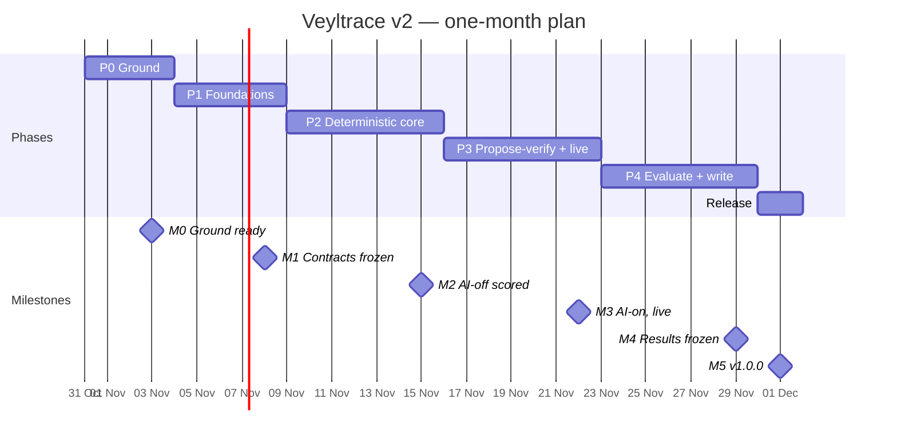

# 07 · Roadmap: phases, milestones, tasks

> **Status:** v1.0 · **Owner:** lead · **Last updated:** 2026-10-30
> Duration: **one month, Sat 31 Oct → Tue 1 Dec 2026**, three people. Lanes: **R** = Reason (Aniket, lead), **O** = Observe (Annapurna), **X** = Explain (Lakshanaa), **L** = everyone / lead-coordinated. Every task below becomes one GitHub issue (title = `<ID> <title>`), assigned to its lane, attached to its milestone.
> Estimates are *estimates* in focused person-days with an AI agent.

## 1. Phases and milestones

| Milestone | Date | Exit criteria (all must hold) | Tag |
|---|---|---|---|
| **M0 Ground ready** | Tue 3 Nov | CI green on `main`; every engine has a stub; `veyltrace diagnose --dataset synth --case synth-01 --ai off` writes every artifact in [02 §4.1](02-architecture.md); contracts v0.1 schemas generated; each laptop benchmarked (`docs/team/<initials>.md`); W1 issues on the board | `v0.0.1` |
| **M1 Contracts frozen** | Sun 8 Nov | All RE2 cases ingest and produce signal cubes; BARO, N-Sigma and alert-count baselines reproduced on RE2 (or discrepancy documented); contracts tagged `1.0`; lab runs one CPU and one delay fault on Online Boutique and captures them | `v0.1.0` |
| **M2 AI-off scored** | Sun 15 Nov | `--ai off` runs on every RE2 case in ≤ 30 s each; per-system AC@1/3/5, Avg@5 and Retrieval@5 with bootstrap CIs vs chance/N-Sigma/BARO/alert-count, under oracle and detected alert protocols; console shows a verdict | `v0.2.0` |
| **M3 AI-on, live** | Sun 22 Nov | `--ai record` (brief mode, local model) on RE2; `veyltrace replay` reproduces `verdict_hash` on 100% of recorded cases; conformal sets + `NO_FAULT` + `INCONCLUSIVE` live; live demo diagnoses an injected fault end to end in ≤ 5 min with `--ai off` (the AI-on result follows on the split or cassette demo, [02 §10](02-architecture.md)); lab collection running nightly | `v0.3.0` |
| **M4 Results frozen** | Sun 29 Nov | Every table/figure in the paper plan regenerates from committed experiment configs; paper draft v1 complete; no open P0/P1 bugs | `v0.9.0` |
| **M5 v1.0.0** | Tue 1 Dec | Release notes from fragments; Zenodo DOI minted; `REPRODUCE.md` verified on a clean clone by someone who did not write it; demo video | `v1.0.0` |

### 1.1 Cut list (if a milestone slips by > 1 day)

Cut in this order, top first. Each cut gets an ADR line so the paper reports it honestly.

1. Anomara TSFM plugin (O-10)
2. FSE'26 TrainTicket adapter (part of O-08)
3. Relentra `investigate` mode (part of X-08) — keep `brief`
4. MCP server (X-12)
5. OTel Demo lab profile (part of X-06) — keep Online Boutique
6. Lab dataset release (X-14) moves to v1.1

**Never cut:** RE2 AI-off pipeline, trials T1–T4, conformal set and abstention, replay, Relentra `brief`, console verdict view, the live demo on Online Boutique.

### 1.2 Critical path

`R-01 → R-02 → O-01 → O-02 → O-04 → R-08 → R-09 → R-10 → M2 → R-12 → M3 → R-16 → M4`

Observe is on the critical path in weeks 1–2. Reason and Explain start on synthetic fixtures from M0, so they never wait for real data; the lead re-checks the critical path at every Wednesday integration check.

## 2. Phase 0 — Ground (Sat 31 Oct – Tue 3 Nov)

| ID | Task | Lane | Est | Depends | Acceptance criteria |
|---|---|---|---|---|---|
| L-00 | GitHub setup: add collaborators; fill real logins in `.github/lanes.yml`; regenerate CODEOWNERS; branch protection ([08 §4.1](08-collaboration-and-git.md)); labels; Project board; milestones M0–M5; create all issues in this file | R | 0.5 | — | protected `main`; board shows every task |
| L-01 | Laptop setup and benchmark ([09 §2](09-ai-agent-playbook.md)): toolchain, `.wslconfig`, Ollama + models, `llama-bench`; write `docs/team/<initials>.md` | all | 0.5 | — | one file per person merged |
| L-02 | Read-in: README → 01 → 02 → 03 → 08 → 09 → own engine docs; file every ambiguity as an issue labelled `type:question` | all | 0.5 | — | ≥ 3 questions each, answered by lead before M0 |
| R-01 | Contracts v0.1: JSON Schemas for every contract in [03](03-contracts.md); `scripts/gen_contracts.py`; generated Pydantic + TS; schema round-trip tests | R | 1 | — | `contracts-in-sync` CI job passes |
| R-02 | Workspace skeleton: root `pyproject.toml` (all members, dev tools), `packages/core` (`canonical_json`, hashing, IDs, `rng`, config loader, contract I/O, `RunContext`, entry-point pipeline runner with the alert step, CLI `diagnose/replay/bench/data`), pre-commit, towncrier, `scripts/check.py` | R | 1.5 | R-01 | `uv sync --all-packages` works on all three laptops |
| R-03 | Synthetic generator `veyltrace_core.synth`: `synth-01…05` (CPU hog, delay, error injection, change-induced regression, no-fault) + bench answer keys | R | 1 | R-02 | deterministic: two runs → identical hashes |
| L-03 | CI workflow: `lint`, `types`, `tests`, `isolation`, `determinism`, `contracts-in-sync`, `lanes`, `changelog` | R | 0.5 | R-02 | all jobs green on `main` |
| O-00 | Stubs for Infralume…Causalith (entry points, schema-valid outputs, golden fixtures for synth) | O | 0.5 | R-02 | e2e on `synth-01` passes through Observe engines |
| R-00 | Stubs for FaultLoom, Causatrix, Causentra | R | 0.5 | R-02 | ditto |
| X-00 | Stubs for Relentra, Causivra; `packages/llm` with a `FakeProvider`; empty `gateway` app; `console` Vite scaffold | X | 0.5 | R-02 | ditto; `pnpm -C console check` passes |

## 3. Phase 1 — Foundations (Wed 4 – Sun 8 Nov) → M1

| ID | Task | Lane | Est | Depends | Acceptance criteria |
|---|---|---|---|---|---|
| O-01 | Infralume: `veyltrace data fetch rcaeval`; `rcaeval` adapter (RE1 metrics; RE2/RE3 metrics, logs, traces); scrubbing + deny-list test; `case_manifest`; error-status rule | O | 2 | O-00 | all RE2 cases ingest; scrub test passes; ≤ 10 s/case |
| O-02 | Signalyth metrics + traces: series, klass tags, edges, self-time, critical path | O | 2 | O-01 | golden + 3 real cases; sorted, deterministic |
| O-03 | Signalyth logs: Drain3 templates with determinism rules; template counts and error rates | O | 1 | O-01 | same templates across two runs and two laptops |
| R-04 | Bench harness v0: answer keys from RCAEval (bench-only), experiment YAML, runner, AC@1/3/5, Avg@5, Retrieval@K, chance; `per_case.csv`, `summary.json` | R | 1.5 | R-03 | runs synth end to end; metrics unit-tested |
| R-05 | Baselines: BARO, N-Sigma via RCAEval's own code (isolated env), SimpleRCA-style alert count, on RE2-OB/SS/TT | R | 1.5 | R-04, O-01 | within ±5 pts of published RCAEval numbers or discrepancy written up |
| R-06 | FaultLoom v0: internal/external anomaly atoms on fixtures; stable `atom_id` | R | 1 | R-00 | golden tests |
| R-07 | Contracts `1.0` freeze: review with all lanes Wed 4 Nov; ADR; tag | R | 0.5 | O-02, R-06 | tag `contracts-1.0` |
| X-01 | `veyltrace_llm`: Ollama, llama.cpp server and OpenAI-compatible providers; JSON-schema constrained calls; cassette record/replay with strict mode | X | 2 | X-00 | replay of a recorded session is byte-identical; strict mode fails on unrecorded calls |
| X-02 | Lab v0 ([05](05-fault-lab-and-dataset.md)): Online Boutique on kind, OTel Collector contrib, Chaos Mesh; one CPU + one delay fault captured as raw OTLP files | X | 2 | L-01 | capture folder + answer key for 2 faults |
| X-03 | Causivra v0: template card + deterministic playbooks per fault class; `card.md` | X | 1 | X-00 | golden card for synth verdict fixtures |

## 4. Phase 2 — Deterministic core (Mon 9 – Sun 15 Nov) → M2

| ID | Task | Lane | Est | Depends | Acceptance criteria |
|---|---|---|---|---|---|
| O-04 | Anomara: robust z + scale floor, N-Sigma, BOCPD onset, silence detector, `t_onset`, `detect_alert()` (detected-alert protocol) | O | 2.5 | O-02 | golden; onset error on synth ≤ 1 step, **measured by bench** (engines never see injection times) |
| O-05 | Causalith: graph from traces/topology/logs; paths; restricted conditional-independence test API | O | 1.5 | O-02 | graph matches synth topology exactly |
| O-06 | Causync: clock alignment, change timeline, change evidence, peer contrast | O | 1.5 | O-04 | synth-04 change found with proximity > 0.5 |
| O-07 | Infralume: OTLP → canonical converter library; `veyllab` adapter | O | 1 | O-01, X-02 | lab captures ingest |
| R-08 | FaultLoom v1: all atom kinds; predicate library with polarity (weights live in `config/causentra.yaml`); symmetric claim pass | R | 2 | O-04, O-05, O-06 fixtures | every predicate unit-tested on synth |
| R-09 | Causatrix v1: six rankers, gated RRF, mode/fault-class rules, slate | R | 2 | R-08 | each ranker reported alone in bench |
| R-10 | Causentra v1: trials T1–T4, decision steps 1–3 and 5–6 (fixed margins, no conformal yet), `verdict_hash` | R | 1.5 | R-09 | determinism gate passes on synth + 3 real cases |
| R-11 | Bench: oracle vs detected alert protocols; full RE2 run; scorecard v1 with per-system bootstrap CIs | R | 1 | R-10 | M2 table generated from a committed config |
| X-04 | Gateway v0: FastAPI endpoints ([06](06-gateway-and-console.md)); OpenAPI → TS types | X | 1.5 | X-03 | contract tests pass |
| X-05 | Console v0: case list, run view, verdict, candidate set, evidence table | X | 2 | X-04 | renders synth + RE2 runs |
| X-06 | Lab v1: fault catalog automation (≥ 8 fault types), load generator, capture packager + answer keys; OTel Demo profile | X | 2 | X-02 | 8 fault types captured once each |
| X-07 | Relentra v0: `brief` mode with evidence cards and constrained proposals on fixtures (FakeProvider), then on the real model | X | 1.5 | X-01, R-08 fixtures | proposals validate against schema 100% |

## 5. Phase 3 — Propose–verify and live (Mon 16 – Sun 22 Nov) → M3

| ID | Task | Lane | Est | Depends | Acceptance criteria |
|---|---|---|---|---|---|
| O-08 | Nezha adapter; FSE'26 TrainTicket adapter if R-07 review confirmed size/format/licence | O | 1.5 | O-01 | Nezha cases ingest |
| O-09 | Robustness hooks: `sources.drop` (telemetry ablation), `alert.shift_s` config passed to core's alert step (onset shift), `events.overlay_path` (merges decoy-change overlays from O-13) | O | 0.5 | O-01 | bench can drive all three |
| O-10 | Anomara TSFM plugin (off by default) — *cut first* | O | 1 | O-04 | ablation arm runs on RE2-OB |
| O-11 | Performance pass: ≤ 30 s and ≤ 3 GB per RE2 case | O | 1 | O-04 | measured on the slowest laptop |
| R-12 | Causentra v2: trials T5–T10, conformal set, `NO_FAULT` threshold, statuses, asks | R | 2 | R-10, R-13 | **held-out** coverage within 1 − α ± 0.05 on RE2 (calibration cases excluded); `NO_FAULT` false-alarm rate on held-out normal windows ≤ β + 0.05 |
| R-13 | Calibration fitting in bench per [04](04-evaluation-protocol.md) splits; writes `config/calibration/<family>.json` (hashed into manifests) | R | 1 | R-11 | calibration file per family |
| O-13 | RCAEval-C: decoy-change generator in `bench/decoys/` + experiment configs (moved from Reason to balance load) | O | 1 | R-11, O-06 | decoys reproducible from seed; Causync treats them like real changes |
| O-14 | Statistics in `bench/stats/`: cluster bootstrap, cluster sign-flip permutation, McNemar + Holm (moved from Reason) | O | 1 | R-11 | validated on a toy example with a known answer |
| X-08 | Relentra v1: budgets, cassette, hash-chained `agent_trace`; `investigate` mode for the ablation | X | 2 | X-07 | 100% replay on recorded RE2 cases |
| X-09 | Causivra v1: LLM narration with placeholders + claim checker + template fallback; receipt (in-toto); `veyltrace replay` exit codes | X | 2 | X-03, X-08 | replay CLI passes on recorded runs; checker rejects seeded bad sentences |
| X-10 | Live: gateway OTLP buffer + snapshot + alert watcher; console live view, evidence graph (Cytoscape.js), timeline (ECharts), receipt view | X | 2.5 | X-04, X-05, O-07 | injected fault → AI-off verdict on screen ≤ 5 min; RAM measured and recorded |
| X-11 | Lab collection: overnight runs on all laptops; validation rule; target ≥ 120 validated cases by M4 | X | 1 | X-06 | daily count posted in standup |

## 6. Phase 4 — Evaluate, harden, write (Mon 23 – Sun 29 Nov) → M4

| ID | Task | Lane | Est | Depends | Acceptance criteria |
|---|---|---|---|---|---|
| R-16 | Full experiment matrix ([04 §6](04-evaluation-protocol.md)), split across laptops by dataset, overnight | R | 2 | M3 | every cell filled or marked "not run" with reason |
| R-17 | Tables and figures generator; result freeze tag | R | 1 | R-16 | `bench/results/tables/*.md` regenerate identically |
| R-18 | Paper draft v1 ([11](11-research-paper-plan.md)): lead writes intro, method, results; lanes write their sections | R | 2 | R-17 | full draft in `paper/` |
| O-12 | Observe docs final; fixtures refreshed; paper sections on data and signals | O | 1.5 | — | reviewed by lead |
| X-12 | MCP server: `diagnose`, `verify_hypothesis`, `get_receipt` — *cut 4th* | X | 1 | X-04 | callable from Claude Code / Codex |
| X-13 | Demo script + 3-minute video; console polish; paper sections on proposer and narration | X | 1.5 | X-10 | video in release assets |
| X-14 | VeylLab packaging: Parquet + answer keys + Croissant metadata draft | X | 1 | X-11 | ships in v1.0 if ≥ 120 validated cases, else v1.1 |
| L-04 | Bug bash (Thu 26 Nov) + full docs review against code | all | 0.5 | — | P0/P1 list empty or assigned |

## 7. Release (Mon 30 Nov – Tue 1 Dec) → M5

| ID | Task | Lane | Est | Acceptance criteria |
|---|---|---|---|---|
| L-05 | `towncrier build`; tag `v1.0.0`; GitHub Release; Zenodo DOI; `CITATION.cff` version + DOI | R | 0.5 | DOI resolves |
| L-06 | `REPRODUCE.md` verified on a clean clone by a teammate who did not write it | O | 0.5 | one command reproduces the headline table |
| L-07 | Retrospective; post-month plan (venue, arXiv endorser, v1.1 scope) recorded in `docs/adr/` | all | 0.5 | ADR merged |

## 8. After the month

See [11-research-paper-plan §7](11-research-paper-plan.md) for venues. Default plan: arXiv preprint + Zenodo artifact in December 2026; submission to KDD 2027 (cycle 2, Feb 2027, date to confirm) or ISSRE 2027 (spring 2027, date inferred); the VeylLab dataset as a separate NeurIPS 2027 Evaluations & Datasets submission if it reaches ≥ 300 validated cases.
