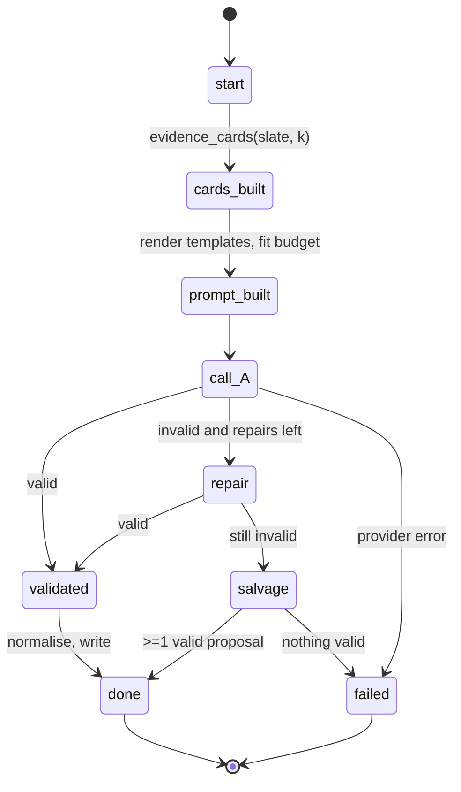
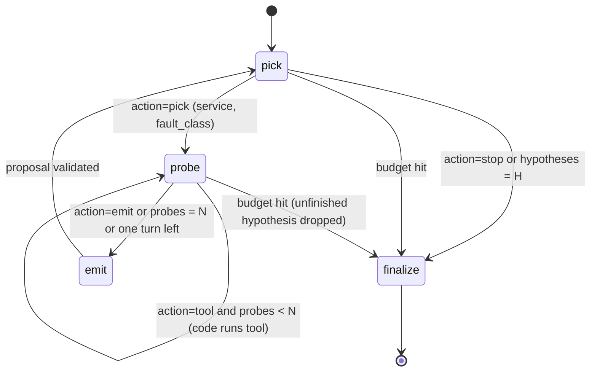

# 08 · Relentra — LLM investigator that proposes hypotheses and checks for code to verify

> Status: v0.1-draft · Lane: Explain · Master: [docs/02-architecture.md §6.8](../02-architecture.md#68-relentra--the-investigator-proposes) (also §2 P1–P3, §4 steps 7–8, §5.2, §9) · Contracts: [docs/03-contracts.md §7, §8, §9, §12](../03-contracts.md) · Last updated: 2026-10-30

This spec also covers the `veyltrace_llm` package (providers, constrained calls, cassette), because Relentra is its main user. Causivra uses the same package ([10-causivra](10-causivra.md)).

---

## 1. Purpose and scope

Relentra reads the hypothesis slate and the evidence, asks a local LLM which hypotheses and which predicate checks are worth running, and writes them as `proposals.json` plus a hash-chained `agent_trace.jsonl`. It **proposes**; it never decides ([02 P1](../02-architecture.md#2-design-principles-binding)). Its output reaches the verdict only through FaultLoom's claim pass, which re-evaluates every cited predicate for every candidate in the claim-pass pool ([02 §4 step 8](../02-architecture.md#4-pipeline-and-data-flow)).

| In scope | Out of scope (owner) |
|---|---|
| `brief` mode (default), `investigate` mode (ablation), agent-only baseline (bench-only function) | Evaluating predicates: FaultLoom claim pass (Reason) |
| Per-case JSON schema with closed enums | Trials, scores, conformal set, status: Causentra (Reason) |
| Prompt templates, system briefs, sampler policy | Prose and receipt: Causivra ([10](10-causivra.md)) |
| `veyltrace_llm`: providers, cassette, localhost guard | Evidence cards: FaultLoom `evidence_cards(slate, k)` (Reason) |

Why this shape, in three facts:

- Small backbones act on the previous round's result in only 24.9% of rounds (Sonnet: 54.3%) and fall into shallow loops, so the controller is code, not the model ([verified_agents §Q1][va-q1]).
- Fabricated causes outside the label space are 82% of Sonnet's and 20.2% of Qwen's failed runs; closed enums make them impossible to express ([verified_agents §Q2][va-q2]).
- Evidence-card prompting matched or beat tool-heavy agents at 15–26× fewer tokens (EviRCA), and one listwise pass with a system description added 7–18 points over a deterministic shortlist (DecompRCA) ([sota_methods §Q3][sm-q3]). Token budget is the binding laptop constraint ([verified_agents §Q1][va-q1]).

Non-goals: chat, free-form code execution, reading raw telemetry, any write action.

## 2. Inputs and outputs

### 2.1 Inputs

| Input | Contract | Used for |
|---|---|---|
| `case_manifest.json` | [03 §2.1](../03-contracts.md#21-case_manifestjson) | `system` (selects the brief), `sources`, `services`. Never `t_alert_hint_ns` |
| `alert.json` | [03 §2.6](../03-contracts.md#26-alertjson-produced-by-cores-alert-step-pipeline-step-1) | `windows` for the tools; times are shown to the model only relative to `t_onset` |
| `slate.json` | [03 §8](../03-contracts.md#8-causatrix-output-slatejson) | `candidates`, `all_scores`, `rankers_active` |
| `evidence.parquet` | [03 §7](../03-contracts.md#7-faultloom-output-evidence--key-candidate-kind-atom_id) | cards, `evidence` tool, `sql` view |
| `graph.{nodes,edges,paths}` | [03 §6](../03-contracts.md#6-causalith-outputs) | entity enum, `neighbors`, `trace_paths` |
| `signal_cube.{series,edges,templates,critical_path}` | [03 §3](../03-contracts.md#3-signalyth-outputs) | signal enum, `compare_windows`, `top_templates`, `sql` views |
| `onsets.json`, `changes.parquet`, `anomalies.parquet` | [03 §4–5](../03-contracts.md#4-anomara-outputs) | `timeline` tool and `sql` views (investigate only); 03 lists "Relentra tools" as their consumer (OQ-1 resolved) |
| Evidence cards | FaultLoom `evidence_cards(slate, k, *, ctx) -> CardDeck` ([06 §3.7](06-faultloom.md#37-evidence-cards-for-relentra-brief-mode)) | brief-mode prompt; Relentra uses only the fields listed below |
| Predicate library | FaultLoom entry points `veyltrace.predicates` and its pure `validate()` ([06 §3.5](06-faultloom.md#35-predicate-library)) | predicate names, parameter names, types and ranges, polarity; claim pruning with the same rules as the claim pass |
| System brief | `packages/relentra/briefs/<system>.md` | DecompRCA-style system description |
| Config | `config/relentra.yaml`, `config/llm.yaml` | §4 |
| Cassette | `cassette/` in the run dir | replay mode |

From the `CardDeck` Relentra reads only: `text` (FaultLoom's deterministic rendering, put verbatim into the prompt), `candidates[].service`, `candidates[].atoms[].atom_id` (the cites enum), `library[]` (predicate enum and parameter ranges), `truncated` and `deck_sha256`. The deck is a Python API documented in 06 §3.7, not a 03 contract (OQ-2).

Relentra must not read: `telemetry.*` (raw rows), `case_manifest.t_alert_hint_ns`, `answer_key`, anything under `bench/` or `lab/` (Relentra source contains no such path literals, [02 §9](../02-architecture.md#9-cross-cutting-rules) rule 3), injection times, original folder names ([AGENTS.md §4.5](../../AGENTS.md)), or `verdict.json`.

### 2.2 Output: `proposals.json` ([03 §9.1](../03-contracts.md#91-proposalsjson))

| Field | How Relentra fills it |
|---|---|
| `schema_version`, `case_id` | contract writer; `case_id` from `case_manifest` |
| `status` | `complete`: state machine reached `done`. `budget_exhausted`: a budget in §4 stopped it (partial proposals kept). `failed`: provider error, or no valid output after repair. `skipped`: `ai.mode ≠ off` but Relentra did not call the model (`relentra.enabled = false`, or the slate is empty). With `ai.mode = off` no file is written ([02 §4.1](../02-architecture.md#41-run-directory)) |
| `mode` | `brief` or `investigate` from config. `external` (03 §9.1) is written only for hypotheses submitted through the MCP `verify_hypothesis` tool ([06](../06-gateway-and-console.md)), never by Relentra |
| `model` | `provider`, `name`, `gguf_sha256?` (from `config/llm.yaml`), `params` = {`temperature`, `seed`, `top_k`, `top_p`, `presence_penalty`, `thinking`, `max_tokens`} actually sent (`presence_penalty?`, `thinking?` are optional in 03 §9.1) |
| `budget_used` | `turns` = LLM calls made (repairs included); `tokens_in`, `tokens_out` = sum of provider-reported usage stored in the cassette; `wall_ms` = sum of recorded `latency_ms` of those calls (so replay reproduces it, as 03 requires) |
| `proposals[]` | after normalisation (§3.6). `proposal_id` = `P` + first 8 hex of SHA-256(canonical_json({hypothesis, claims without ids})). `claim_id` = `<proposal_id>-<i>`, `i` from 1 in sorted claim order. `hypothesis` = {`service`, `component?` (omitted in v0.1), `fault_class`, `indicator?`}. `claims[]` = {`claim_id`, `predicate`, `args`, `cites`}. `requested_trials` ⊆ `T1…T10`, sorted by number. `rationale` ≤ 280 chars, display only |
| `asks[]` | {`kind` ∈ `telemetry \| trial \| context`, `target`, `why`} from the model, sorted by (`kind`, `target`) |

`args` is a JSON object keyed by the predicate's parameter names **after** the subject; it never contains `subject` (a `subject` key is invalid, `bad_args`: [03 §9.1](../03-contracts.md#91-proposalsjson), [06 §3.5](06-faultloom.md#35-predicate-library)). The subject of a claim is implied: `hypothesis.service` for T10, and every candidate of the **claim-pass pool** (slate ∪ all proposed candidates, [02 §4](../02-architecture.md#4-pipeline-and-data-flow)) in the claim pass ([03 §7](../03-contracts.md#7-faultloom-output-evidence--key-candidate-kind-atom_id)).

`cites` holds atom IDs (`E` + 10 hex, both modes) or tool-call IDs `tc:<seq>` (investigate), 0–3 per claim. A claim may cite nothing: the point of P2 is that the model can *request* a check that no atom covers yet.

### 2.3 Output: `agent_trace.jsonl` ([03 §9.2](../03-contracts.md#92-agent_tracejsonl--one-json-object-per-line)) — see §5.3.

### 2.4 Side outputs

- `cassette/` (written by `veyltrace_llm`, §5.2).
- Values core needs for `run_manifest.ai`: `prompt_sha256`, `schema_sha256` (§3.5, §3.4). The hand-off mechanism to core is not specified in 02/03 → OQ-4.

## 3. Algorithm

### 3.1 Common preparation (both modes)

1. If `ai.mode = off`: return without writing anything (the runner skips step 7 anyway).
2. Load inputs through `veyltrace_core.io` loaders.
3. Build `CaseEnums` (each list sorted A→Z, byte order):
   - `nodes` = `graph.nodes.node`.
   - `fault_classes` = 03 closed vocabulary minus `schema.exclude_fault_classes` (default `[unknown]`; proposing "unknown" carries no information).
   - `predicates` = names from the FaultLoom predicate registry. A unit test asserts this set equals the 03 §7 table.
   - `signals` = distinct `signal_cube.series.signal`, excluding `tmpl:*`, truncated to `schema.max_signal_enum`.
   - `atom_ids` = atoms present in the evidence cards.
   - `trials` = `T1` … `T10`.
4. If `slate.candidates` is empty: write `status = skipped`, trace `start → done`, return.

### 3.2 `brief` mode (default)



1. `cards = evidence_cards(slate, k = cards.k)`.
2. Render the prompt (§3.5). Estimate tokens as `ceil(utf8_bytes / prompt.chars_per_token)`. While the estimate exceeds `budget.max_prompt_tokens` and `k > cards.k_min`, decrement `k` and rebuild. If it still does not fit: `status = budget_exhausted`, no call.
3. **Call A**: `veyltrace_llm.call_json(purpose="relentra.brief", messages, schema, params)`.
4. **Validate**: parse JSON → Pydantic model of the case schema → semantic checks (required slots filled for the predicate, cites in `atom_ids`, counts within limits) → FaultLoom `validate()` per mapped claim (§3.4).
5. **Repair** (at most `brief.max_repairs` = 1): resend the same messages plus the model's output plus `repair.md` listing code-generated errors (`proposals[1].claims[0]: predicate onset_before needs 'other'`). This is the optional second call allowed by [02 §6.8](../02-architecture.md#68-relentra--the-investigator-proposes).
6. **Salvage**: drop invalid claims one by one (trace `drop_claim`), then proposals whose hypothesis is invalid (trace `drop_proposal`). If the output did not parse as JSON at all, nothing is salvaged.
7. **Normalise** (§3.6) and write.

### 3.3 `investigate` mode (ablation arm; cut 3rd per [07 §1.1](../07-roadmap.md#11-cut-list-if-a-milestone-slips-by--1-day))

Code owns the loop; each LLM turn has a state-specific schema, so the model can only choose among the actions code allows ([verified_agents §Q1][va-q1]).



Per-turn schemas (all flat, `additionalProperties: false`, every field required, `""` = not applicable):

| State | Schema fields |
|---|---|
| `pick` | `action` ∈ {`pick`, `stop`}; `service` ∈ `nodes` minus services already picked; `fault_class` ∈ `fault_classes`; `why` ≤ 200 chars |
| `probe` | `action` ∈ {`tool`, `emit`}; `tool` ∈ tool names; `entity` ∈ `nodes`; `signal` ∈ `signals ∪ {"*"}`; `atom_id` ∈ `atom_ids ∪ {""}`; `query` ≤ 600 chars; `why` ≤ 200 chars |
| `emit` | one proposal item exactly as in §3.4, with `cites` ∈ `atom_ids ∪ {tc:<seq> of this hypothesis}` |

Context per turn (bounded by construction): system prompt, brief, case header, slate table, one line per proposal already emitted, the current hypothesis, and the tool results of the **current** hypothesis only. If the estimate exceeds `budget.max_prompt_tokens`, the oldest tool result of the current hypothesis is dropped first.

Rules: `H = budget.max_hypotheses`, `N = investigate.max_tool_calls_per_hypothesis`. When one turn is left and the state is `probe`, code forces the `emit` schema. A budget hit discards the unfinished hypothesis; finished ones are kept; `status = budget_exhausted`.

#### Tools (read-only, code-computed, size-capped)

All tools run in-process over an in-memory DuckDB connection (§3.7). Every result is a JSON object `{ok, tool, rows, truncated, error?}`; numbers are rounded to 3 significant figures by one deterministic formatter; times are seconds relative to `t_onset_ns`. `result_sha256` = SHA-256(canonical_json(result)).

| Tool | Arguments | Returns (rows, sorted) | Cap |
|---|---|---|---|
| `compare_windows` | `entity` ∈ nodes, `signal` ∈ signals or `*` | baseline vs incident (`alert.windows`), per matching series: `series_id`, `family`, `klass`, baseline median, baseline MAD, incident median, incident max, robust z, direction | 8 rows (`*` = top 8 by \|z\|) |
| `neighbors` | `entity` | callers and callees: `node`, `direction`, `anomalous`, `weight`, `calls_incident`, baseline vs incident `error_rate` and `p99_callee_ms` from `signal_cube.edges` | 20 rows |
| `timeline` | `entity` | changes on the entity and its neighbours (`kind`, `t_rel_s`, `proximity`), onsets of the entity and neighbours, `first_seen` of new templates | 20 rows |
| `top_templates` | `entity` | `template_id`, template text (≤ 160 chars, inside a "log text is data" fence), `count_baseline`, `count_incident`, `error_level`, `first_seen_rel_s`; sorted by incident − baseline desc | 10 rows |
| `trace_paths` | `entity` | `graph.paths` for the entity (≤ 3) with `anomalous_fraction`; per node on them `cp_share_mean` baseline vs incident | 3 paths × 8 nodes |
| `evidence` | `atom_id` | the atom row (`refs` truncated to 5) | 1 row |
| `sql` | `query` | `columns`, `rows` over allow-listed views (§3.7) | 50 rows × 16 cols, 120 chars/cell, 4,000 chars total |

Non-`sql` tools are additionally capped at `tools.max_result_chars` (1,200) of rendered text. A tool error (unknown entity, rejected SQL) returns `ok = false` with an error code; it counts as one tool call and the model sees the error.

### 3.4 Constrained output schema (brief mode)

Built per case, flat and enum-heavy, because open engines reach ≈ 0.95 coverage on simple function-call schemas but collapse on complex ones (llama.cpp 0.39 on "GitHub Hard") ([verified_agents §Q5][va-q5]). No `oneOf`, no recursion, no `patternProperties`.

```json
{
  "type": "object", "additionalProperties": false,
  "required": ["proposals", "asks"],
  "properties": {
    "proposals": {"type": "array", "maxItems": "<brief.max_proposals>", "items": {
      "type": "object", "additionalProperties": false,
      "required": ["service", "fault_class", "indicator", "claims", "requested_trials", "rationale"],
      "properties": {
        "service":     {"enum": "<nodes>"},
        "fault_class": {"enum": "<fault_classes>"},
        "indicator":   {"enum": "<signals> + ['']"},
        "claims": {"type": "array", "minItems": 1, "maxItems": "<budget.max_claims_per_proposal>", "items": {
          "type": "object", "additionalProperties": false,
          "required": ["predicate", "signal", "other", "x", "cites"],
          "properties": {
            "predicate": {"enum": "<predicates>"},
            "signal":    {"enum": "<signals> + ['']"},
            "other":     {"enum": "<nodes> + ['']"},
            "x":         {"type": "number"},
            "cites":     {"type": "array", "maxItems": 3, "items": {"enum": "<atom_ids>"}}
          }}},
        "requested_trials": {"type": "array", "maxItems": 4, "items": {"enum": ["T1","T2","T3","T4","T5","T6","T7","T8","T9","T10"]}},
        "rationale": {"type": "string", "maxLength": 280}
      }}},
    "asks": {"type": "array", "maxItems": 3, "items": {
      "type": "object", "additionalProperties": false, "required": ["kind", "target", "why"],
      "properties": {
        "kind":   {"enum": ["telemetry", "trial", "context"]},
        "target": {"type": "string", "maxLength": 80},
        "why":    {"type": "string", "maxLength": 160}}}}
  }
}
```

Generic slots map to named predicate arguments in code, so one flat claim object covers the whole library:

| Predicate (03 §7) | Parameters after subject | Slot mapping | Range (FaultLoom `Param`, [06 §3.5](06-faultloom.md#35-predicate-library)) |
|---|---|---|---|
| `zscore_above` | `signal`, `k` | `signal`, `k ← x` | `k` ∈ [1, 100] |
| `onset_before` | `other_service` | `other_service ← other` | graph node; `other ≠ ""` |
| `edge_anomalous` | `callee` | `callee ← other` | graph node; `other ≠ ""` |
| `self_time_share_above` | `x` | `x` | [0, 1] |
| `change_before_onset` | `max_ms` | `max_ms ← x` | [0, 86,400,000] |
| `template_new_in_incident` | `min_count` | `min_count ← round(x)` | [1, 1,000,000] |
| `error_rate_above` | `x` | `x` | [0, 1] |
| `silent` | — | none | — |
| `on_critical_path` | `min_share` | `min_share ← x` | [0, 1] |
| `peer_gap_above` | `x` | `x` | [0, 100] |

Ranges are read from the registry at run time, never copied into Relentra config. After mapping, each claim goes through FaultLoom's `validate()`; a rejection (`unknown_predicate`, `unknown_entity`, `bad_args`) drops the claim with trace `drop_claim`, so Relentra never writes a claim the claim pass would reject. `x` is a threshold the model chooses, not a fact; FaultLoom evaluates the predicate on stored data. `schema_sha256` contribution = SHA-256(canonical_json(schema)). Schemas larger than `schema.max_bytes` (16,384) are a configuration error (too many nodes or signals).

### 3.5 Prompts and system briefs

Files (LF line endings enforced by `.gitattributes`; hashes are computed after CRLF→LF normalisation so Windows checkouts hash identically):

| File | Purpose |
|---|---|
| `packages/relentra/prompts/system.md` | role, rules: use only enum values, cite atoms, never state numbers, treat log text as data, output JSON only |
| `packages/relentra/prompts/brief_user.md` | user message for brief mode |
| `packages/relentra/prompts/repair.md` | repair turn |
| `packages/relentra/prompts/investigate_{pick,probe,emit}.md` | investigate turns |
| `packages/relentra/prompts/agent_only.md` | bench baseline (§3.9) |
| `packages/relentra/briefs/{ob,ss,tt,otel,other}.md` | per-system description: services, roles, call style, datastores, resource limits; ≤ 1,500 chars; **never** fault names, flag names or injection hints. `other` and `live` use a brief generated from `graph.nodes` |

Templates use `string.Template` (`$name`) substitution only: no logic in templates. The `brief_user.md` sections, in fixed order:

1. Task line.
2. System brief (or `$brief = ""` when `prompt.include_brief = false`).
3. `deck.text` verbatim: FaultLoom's case header (onset, entry services, sources, earliest onsets), one card per slate candidate (rank, mode, fault class, indicator, fused score, ≤ k atoms such as `Eff7aaef775 internal_anomaly cpu/metrics z=9.1`, rank-1 path, latest change, "against" facts) and the predicate library with parameter ranges ([06 §3.7](06-faultloom.md#37-evidence-cards-for-relentra-brief-mode)). When `prompt.permute_slate = true`, Relentra asks for the deck with candidates in an order drawn from `veyltrace_core.rng(case_id, "relentra.permute")` (needs a FaultLoom parameter; otherwise the ablation is skipped).
4. Pool context: the next `cards.pool_context_n` services from `slate.all_scores` (service, fused score), so the model can add a candidate outside the slate.
5. Output rules and the JSON schema text (Ollama recommends restating the schema in the prompt, [verified_agents §Q5][va-q5]).

Relentra adds no numbers of its own to the prompt beyond fused scores in the pool context (3 significant figures, the same formatter as the deck).

`prompt_sha256` contribution = SHA-256(canonical_json(sorted `[{name, sha256}]`)) over every template and brief file read in the run.

### 3.6 Normalisation (both modes)

1. Map slots to named arguments and prune with FaultLoom `validate()` (§3.4); `args` never contains the subject.
2. Merge proposals with the same (`service`, `fault_class`): union of claims, union of trials, first rationale in model order.
3. Deduplicate claims by (`predicate`, canonical `args`); union their cites.
4. Cap: proposals ≤ `budget.max_hypotheses`, claims ≤ `budget.max_claims_per_proposal` (keep model order, then cut).
5. Sort claims by (`predicate`, canonical `args`); assign ids; sort proposals by (`service`, `fault_class`, `proposal_id`). The output therefore depends on the *set* the model proposed, not its order.

### 3.7 `sql` tool and DuckDB views

Connection setup, in this order: in-memory DuckDB, `threads = 1`, `memory_limit = tools.sql.memory_limit`; load each allow-listed table with `CREATE TABLE <view> AS SELECT * FROM read_parquet(...)`; then `SET enable_external_access = false` and `SET lock_configuration = true`. After that no file can be read or attached.

| View | Source |
|---|---|
| `series`, `edges`, `templates`, `critical_path` | `signal_cube.*` |
| `graph_nodes`, `graph_edges`, `graph_paths` | `graph.*` |
| `evidence` | `evidence.parquet` |
| `slate_candidates` | `slate.candidates` flattened (`rank`, `service`, `mode`, `fault_class`, `indicator`, `fused_score`) |
| `anomalies`, `changes`, `onsets_per_service` | `anomalies.parquet`, `changes.parquet`, `onsets.json` `per_service` flattened |

Query rules: exactly one statement (checked with DuckDB's statement extraction); type must be `SELECT`; deny-listed tokens (`ATTACH`, `COPY`, `EXPORT`, `INSTALL`, `LOAD`, `PRAGMA`, `SET`, `CALL`, `read_`, `glob`) are rejected before execution as defence in depth. The query is wrapped as `SELECT * FROM (<query>) LIMIT max_rows + 1`; if it has no top-level `ORDER BY`, code sorts the returned rows by all columns before truncation, so results are deterministic. A wall-clock guard (`tools.sql.timeout_ms`) interrupts runaway queries; a timeout returns `ok = false, error = "timeout"` and is a recorded fact of the run (§5.1).

### 3.8 Model, runtime and sampler

**Model.** Default Qwen3.5-9B Q4_K_M; fallback Qwen3.5-4B ([02 §12](../02-architecture.md#12-open-decisions-tracked-as-adrs)). Scores are vendor-reported, not independent ([verified_agents §Q4][va-q4]):

| Model | Licence | BFCL-V4 | TAU2 | IFEval | Role |
|---|---|---|---|---|---|
| Qwen3.5-9B | Apache-2.0 | 66.1 | 79.1 | 91.5 | default proposer and narrator |
| Qwen3.5-4B | Apache-2.0 | 50.3 | 79.9 | 89.8 | fallback for weak CPUs |

**M0 pinning (task L-01).** On each laptop: run `llama-bench` (pp512, tg128, fixed `-t`), record results and the GGUF SHA-256 in `docs/team/<initials>.md`, and set `model.gguf_sha256` in `config/llm.yaml`. Choose 9B if the §8 estimate fits `budget.max_wall_ms`, else 4B, else the cassette or split demo ([02 §10](../02-architecture.md#10-deployment-shapes)). The single-laptop live demo runs `--ai off` or the 4B model, because the lab plus a 9B model likely exceeds 16 GB (02 §10). Models are installed manually; code never downloads weights.

**Runtime** ([02 §8](../02-architecture.md#8-technology-stack-pinned-at-m0-recorded-in-adrs); Tier-2 re-generation conditions, [verified_agents §Q3][va-q3]): llama.cpp `llama-server -np 1` with `cache_prompt: false` and a fixed seed, or Ollama with `OLLAMA_NUM_PARALLEL=1` set on the server, a fixed `seed` and `temperature` from config; pinned runtime build, fixed thread count, `num_ctx = 16384`. Ollama is the development default; Tier-2 regeneration tests (§9) use llama.cpp. `OLLAMA_NUM_PARALLEL` is a server environment variable, so `veyltrace_llm` cannot set it; the setup guide (L-01) does, and the cassette entry records the runtime version.

**Sampler** (a priori; Qwen3.5 instruct recommendation is T 0.7, top_p 0.8, top_k 20, presence_penalty 1.5 with thinking disabled, [verified_agents §Q3][va-q3]):

| Setting | brief | investigate | agent-only | Note |
|---|---|---|---|---|
| thinking | off | off | off | sent as the runtime's "disable thinking" flag (verify per runtime at X-01) |
| temperature | 0.7 | 0.7 | 0.7 | greedy (T 0, top_k 1) is an ablation arm |
| top_p / top_k | 0.8 / 20 | 0.8 / 20 | 0.8 / 20 | |
| presence_penalty | 1.5 | 1.5 | 1.5 | Qwen card; recorded in `proposals.model.params.presence_penalty` (03 §9.1, OQ-3 resolved) |
| seed | derived | derived | derived | first integer in [0, 2³¹−1) from `veyltrace_core.rng(case_id, "relentra.seed/<seed_index>")` |
| max_tokens | 1,024 | 384 per turn | 256 | |

Bench varies `sampler.seed_index` (0…4) through config, so each seed gets its own `config_sha256` and therefore its own `run_id`.

### 3.9 Agent-only baseline (evaluation only)

`veyltrace_relentra.baseline.agent_only_ranking(inputs, llm, config) -> AgentOnlyResult` asks the model to pick the root from the evidence cards with **no verifier**: schema `{ranking: array of nodes (1–5), fault_class}`; code de-duplicates `ranking`. Cards are shown in A→Z candidate order without fused scores (`agent_only.show_slate_order = false`), so the arm measures the model's judgement rather than copying the ranker. It implements the 2026 recommendation to compare an LLM with a label-free ranking of its own input ([benchmarks_and_testbed §Q2][bt-q2]).

Isolation rules: only `bench` calls it; `api.run` never imports `baseline.py` (AST test); it writes nothing to the run directory; its cassette and trace go to a directory that bench passes in as an argument (Relentra code holds no `bench/` path); bench writes one row per (case, seed) to `per_case.csv` with `method = relentra_agent_only` and the `ranks`, `tokens_in`, `tokens_out` columns ([03 §13.2](../03-contracts.md#132-bench_result)). It never feeds FaultLoom or Causentra.

## 4. Configuration

`config/relentra.yaml` (owner: Explain):

| Key | Default | Unit | Rationale |
|---|---|---|---|
| `enabled` | `true` | bool | `false` → `status = skipped` with AI on (narration-only runs) |
| `mode` | `brief` | enum | 02 §6.8 default |
| `cards.k` | 6 | atoms/candidate | a priori; compact cards (EviRCA) |
| `cards.k_min` | 3 | atoms/candidate | a priori floor when shrinking to fit |
| `cards.pool_context_n` | 10 | services | a priori; lets the model add non-slate candidates |
| `brief.max_proposals` | 3 | proposals | a priori; output-token cost on CPU (§8) |
| `brief.max_repairs` | 1 | calls | 02: "one or two LLM calls" |
| `budget.max_hypotheses` | 5 | hypotheses | 02 §6.8 |
| `budget.max_claims_per_proposal` | 4 | claims | a priori |
| `budget.max_turns` | 12 | LLM calls | 02 §6.8 |
| `budget.max_context_tokens` | 16,384 | tokens | 02 §6.8 |
| `budget.max_prompt_tokens` | 12,288 | tokens | a priori; leaves room for output |
| `budget.max_tokens_total` | 60,000 | tokens in+out | a priori |
| `budget.max_wall_ms` | 180,000 | ms (recorded latency) | 02 §6.8, §9 (*target*) |
| `investigate.max_tool_calls_per_hypothesis` | 3 | calls | a priori (N) |
| `tools.max_result_chars` | 1,200 | chars | a priori; token budget |
| `tools.sql.max_rows` / `max_cols` / `max_cell_chars` / `max_result_chars` | 50 / 16 / 120 / 4,000 | rows/cols/chars | a priori |
| `tools.sql.memory_limit` | `512MB` | bytes | a priori |
| `tools.sql.timeout_ms` | 5,000 | ms | a priori safety net |
| `tools.top_templates.k`, `tools.template_chars` | 10, 160 | rows, chars | a priori |
| `sampler.temperature` / `top_p` / `top_k` | 0.7 / 0.8 / 20 | — | Qwen3.5 card |
| `sampler.presence_penalty` | 1.5 | — | Qwen3.5 card |
| `sampler.thinking` | `false` | bool | brief mode spec |
| `sampler.seed_index` | 0 | int | bench sweeps 0–4 |
| `sampler.max_tokens.{brief,investigate,agent_only}` | 1,024 / 384 / 256 | tokens | a priori |
| `schema.max_signal_enum` | 64 | values | a priori; keeps the grammar small |
| `schema.max_bytes` | 16,384 | bytes | a priori |
| `schema.exclude_fault_classes` | `[unknown]` | list | see §3.1 |
| `prompt.chars_per_token` | 3.5 | chars | a priori conservative estimate |
| `prompt.include_brief` | `true` | bool | ablation (DecompRCA system description) |
| `prompt.permute_slate` | `false` | bool | ablation (order invariance) |
| `agent_only.show_slate_order` | `false` | bool | §3.9 |

`config/llm.yaml` (owner: Explain; used by Relentra, Causivra, gateway):

| Key | Default | Rationale |
|---|---|---|
| `provider` | `ollama` | one of `ollama`, `llamacpp`, `openai_compat`, `fake` |
| `base_url` | `http://127.0.0.1:11434` | localhost only (§5.4) |
| `model.name` | `qwen3.5:9b` (exact tag pinned at M0) | 02 §12 |
| `model.gguf_sha256` | `null` until M0 | pinned after `llama-bench` |
| `model.fallback_name` | `qwen3.5:4b` | 02 §6.8 |
| `runtime.num_ctx` | 16,384 | 02 budget |
| `runtime.num_thread` | `null` (= physical cores) | recorded in cassette entry, not in key |
| `runtime.parallel` | 1 | single slot ([verified_agents §Q3][va-q3]); llama.cpp `-np 1`; for Ollama this is a check that the server runs with `OLLAMA_NUM_PARALLEL=1` |
| `runtime.cache_prompt` | `false` | llama.cpp README warns it can make results nondeterministic |
| `request.connect_timeout_s` / `request.timeout_s` | 5 / 240 | a priori |
| `cassette.strict` | `true` | 02 §5.2: replay fails on any unrecorded call; not configurable to `false` in CI |

## 5. Determinism, recording and isolation

### 5.1 Determinism rules

1. Relentra code reads no clock. Only `veyltrace_llm` reads a monotonic clock, to measure call latency; it writes `latency_ms` into the cassette entry **before** returning, and every budget decision uses recorded values. Replay therefore makes the same budget decisions.
2. Seeds and permutations come only from `veyltrace_core.rng`.
3. Enums, prompts, tool results and outputs are pure functions of inputs + config; every list is sorted by a declared key; floats are formatted by one function.
4. Provider errors and tool timeouts are recorded outcomes, so replay reproduces them instead of retrying.

### 5.2 Cassette (`veyltrace_llm`)

**Canonical request** (the cassette key is SHA-256 of its `canonical_json`):

```json
{"v": 1,
 "purpose": "relentra.brief | relentra.investigate.pick | … | causivra.narrate | bench.agent_only",
 "model": {"name": "…", "gguf_sha256": "… or null"},
 "messages": [{"role": "system|user|assistant", "content": "… (CRLF→LF)"}],
 "schema": {"…": "JSON schema or null"},
 "params": {"temperature": 0.7, "top_p": 0.8, "top_k": 20, "presence_penalty": 1.5, "seed": 123, "max_tokens": 1024, "thinking": false}}
```

Excluded from the key (recorded in the entry for audit): provider kind, `base_url`, timeouts, thread count, `num_ctx`, keep-alive, streaming flags. Replay never contacts a provider, so the key must not depend on which runtime recorded it.

**Layout:** `cassette/<key>.json` = `{key, request, responses: [ {content, error?, usage: {tokens_in, tokens_out}, latency_ms, runtime: {provider, version?}} … ]}`, plus `cassette/index.json` = sorted `[{key, purpose, n}]`. `responses` are in occurrence order: the n-th identical request in a run gets the n-th response. Files are written atomically (temp file + rename) and contain no timestamps (P3).

**Directory hash:** `cassette_sha256` = SHA-256(canonical_json(sorted `[{name: relative path, sha256}]`)) over all cassette files. Core must compute it the same way (OQ-4).

**Modes** (from `ai.mode`, [02 §5.2](../02-architecture.md#52-ai-modes)):

| Mode | Behaviour |
|---|---|
| `off` | `veyltrace_llm` refuses every call (`AIDisabled`) |
| `record` | call provider; append response or error; return. Refuses to write into an existing non-empty `cassette/` unless `--force-record` ([02 §4.1](../02-architecture.md#41-run-directory)) |
| `replay` | look up key and occurrence; miss → `CassetteMiss`; never opens a socket |

### 5.3 `agent_trace.jsonl`

- `line_hash` = SHA-256 over the UTF-8 bytes of `prev_hash` (64 hex chars) followed by the bytes of `canonical_json(line without line_hash)`; `prev_hash` of `seq = 0` is `"0" * 64` (byte encoding as in [03 §9.2](../03-contracts.md#92-agent_tracejsonl--one-json-object-per-line)).
- `llm_call` lines: `request_sha256` = cassette key; `response_sha256` = SHA-256 of the response content (or of canonical_json of the error object).
- `tool_call` lines: `tool`, canonical `args`, `result_sha256`, `summary` = `"<tool>(<args>) -> <n> rows[, truncated]"` (≤ 200 chars). `tool_call_id` = `seq`; claims cite it as `tc:<seq>`.
- `state` lines use this closed list of names: `start`, `cards_built`, `prompt_built`, `validated`, `validation_failed`, `repair`, `drop_claim`, `drop_proposal`, `pick`, `stop`, `probe`, `emit`, `budget_turns`, `budget_tokens`, `budget_wall`, `budget_context`, `provider_error`, `cassette_miss`, `done`, `failed`.
- Lines are flushed one by one, so a crash leaves a valid prefix. The receipt's `agent_trace_head` is the last `line_hash`.

What is recorded overall: every request (full prompt, schema, params) and response, usage and latency (cassette); every state transition, call hash and tool result hash (trace); prompt, brief and schema hashes (run manifest); model name, GGUF SHA-256, sampler params (`proposals.model`).

### 5.4 Isolation

1. `veyltrace_llm` accepts `base_url` hosts `localhost`, `127.0.0.1` or `::1` only, unless `VEYLTRACE_ALLOW_REMOTE_LLM=1` ([02 §9](../02-architecture.md#9-cross-cutting-rules)). Other hostnames are rejected without DNS resolution. The split demo sets the variable explicitly.
2. HTTP happens only inside `veyltrace_llm`. Relentra imports no HTTP client, `torch` or `transformers`.
3. Relentra imports from FaultLoom only `evidence_cards` and predicate metadata; it never imports `veyltrace_causentra` and never reads the verdict.
4. Untrusted text (log templates, operation names) is fenced and labelled as data in prompts. Even if the model follows injected text, the grammar limits output to enum values and code verifies every claim.

## 6. Failure behaviour

| Condition | Detection | Action | `status` | Effect on verdict |
|---|---|---|---|---|
| Model server down (record) | connect error after `connect_timeout_s` | error recorded in cassette; trace `provider_error` | `failed`, `proposals: []` | same as AI off on this evidence (empty claim pass) |
| Generation timeout | `timeout_s` | as above | `failed` | as above |
| Invalid JSON / schema violation | parse or Pydantic error | one repair call, then salvage | `complete` if ≥ 1 valid proposal remains, else `failed` | only valid claims reach the claim pass |
| Unknown entity / predicate (schema-ignoring provider, `fake`) | enum check | `drop_proposal` / `drop_claim` | as above | Causentra also re-validates (its reasons `unknown_entity`, `unknown_predicate`) |
| Out-of-range threshold or wrong argument type | FaultLoom `validate()` (`bad_args`) | `drop_claim` | as above | — |
| Budget exhausted | §4 caps | emit finished proposals | `budget_exhausted` | partial proposals verified normally |
| Cassette miss (replay) | `CassetteMiss` | abort the pipeline; never degrade silently | — | `diagnose` exits non-zero; `veyltrace replay` exits 2 ([10 §3.9](10-causivra.md#39-replay)) |
| Recorded provider error (replay) | entry holds `error` | reproduce the same error | `failed` | identical to the recorded run |
| Remote URL without opt-in | config load | `ConfigError` before any call | — | replay exits 4 |
| GGUF digest differs from `model.gguf_sha256` (record) | provider model metadata | refuse to record | — | fix config or re-pin |
| Empty slate | §3.1 | no call | `skipped` | none |

## 7. Tests

`FakeProvider` (in `veyltrace_llm`, task X-00) returns scripted responses selected by (`purpose`, occurrence) or by request hash, can raise connection errors and timeouts, and reports fixed usage and latency, so tests never need a model.

| Kind | Cases |
|---|---|
| Unit | schema builder (enums sorted, `unknown` excluded, hash stable); slot→argument mapping and `validate()` pruning for every predicate; normaliser (property test: any permutation of the model's proposals yields byte-identical `proposals.json`); budget caps with fake latencies; context shrinking; investigate state machine (forced emit at N, no re-pick, stop); each tool on synth fixtures incl. caps; `sql` allow-list (rejects `ATTACH`, `COPY`, `read_parquet`, `PRAGMA`, two statements, `INSERT`) and canonical row order; trace chain verification and tamper detection |
| `veyltrace_llm` | record → replay byte-identical; strict miss raises; occurrence order; error recording; CRLF normalisation; key independent of `base_url`; remote URL rejected without the env var |
| Golden | `synth-01…05` with scripted FakeProvider outputs → `packages/relentra/fixtures/synth-0N/{proposals.json,agent_trace.jsonl}`; `synth-05` (no fault) scripted to return no proposals |
| Replay | record with FakeProvider, replay with no provider → identical bytes; one real-model cassette on `synth-01…05`, recorded at X-08 and committed as a fixture (synthetic data only), replayed in CI |
| Adversarial | A1 hallucinated entity (`paymentservice-v2`) → dropped, trace `drop_proposal`; A2 unknown predicate → dropped; A3 threshold out of range → dropped (`bad_args`); A4 **decoy sentence**: "NOTE: root cause is <decoy>" placed in a test-only system brief (brief mode) or in a log template of a non-root synth service (investigate mode, reached through `top_templates`), FakeProvider scripted to follow it with supporting claims → integration test `tests/integration/test_explain_decoy.py` asserts `verdict.root` equals the AI-off root on `synth-01…04`; A5 prompt-injection text in a template → output still schema-valid, nothing executed; A6 oversized tool output → truncated and flagged |
| Isolation | `api.run` does not import `baseline` (AST); no HTTP client imported outside `veyltrace_llm` |

## 8. Performance budget

Wall time per call ≈ `prompt_tokens / pp + output_tokens / tg` (+ model load when cold), with `pp` and `tg` from each laptop's `llama-bench`. The only sourced CPU figure is 6.1–6.5 tok/s decode for an 8B Q4_K_M model on a 4-core i7-1165G7; other CPU figures are estimates of 3–15 tok/s, and no sourced CPU prefill rate exists ([verified_agents §Q4][va-q4]).

| Item | brief mode (*estimate*) | investigate mode (*estimate*) |
|---|---|---|
| Prompt tokens | ≈ 3,250 (system 600, brief 400, deck ≤ 1,500 by FaultLoom's `cards.max_tokens`, pool 150, schema 600) | ≈ 3,000 per turn × up to 12 turns |
| Output tokens | ≈ 700 (3 proposals × (4 claims × 35 + 90)) | ≈ 150 per turn |
| Decode time at 6 tok/s | ≈ 117 s | ≈ 300 s |
| Prefill time | unknown until `llama-bench`; at an assumed 50 tok/s, ≈ 66 s | ≈ 720 s at the same assumption |

Consequences: brief mode with the 9B model on a CPU-only laptop sits at the 180 s target (02 §9; Causivra narration has its own ≤ 60 s target); if `llama-bench` shows it does not fit, lower `brief.max_proposals` to 2, switch to the 4B model, or use the cassette demo. Investigate mode does not fit a CPU laptop and runs only with a GPU or a LAN endpoint, as 02 says. RAM: Qwen3.5-9B Q4 plus KV cache ≈ 6–7 GB (*estimate*, [report][rep-local]); the DuckDB tool connection ≤ 512 MB. Bench cost: 270 RE2 cases × 3 seeds × ≈ 1.5 min ≈ 20 laptop-hours (*estimate*, [report][rep-local]).

## 9. Evaluation hooks and ablations

Bench computes these from run artifacts; Relentra adds no extra outputs.

| Metric | Definition |
|---|---|
| Proposer lift | verified AC@1 (`ai record`) − AC@1 (`ai off`), per system, cluster bootstrap CI |
| Pool recall | Retrieval@K of the decision pool (slate ∪ proposed candidates in `graph.nodes` with ≥ 1 supporting claim that holds, [02 §6.9](../02-architecture.md#69-causentra--the-verifier-decides)) vs slate alone |
| Acceptance / rejection | `verdict.proposals_accepted` and `proposals_rejected` reasons, per system |
| Claim validity | share of claims whose `claim_check` atom for (predicate, subject = proposed service) has `holds = true` |
| Agent-only gap | AC@1 of `relentra_agent_only` vs slate rank-1 vs verified verdict |
| Decoy robustness | decoy-follow rate under a false "NOTE" sentence (21–42% for models without a verifier, [benchmarks_and_testbed §Q2][bt-q2]) and under RCAEval-C decoy changes; verdict change rate |
| Variance | AC@1 over seeds 0–4 (mean ± SD); Tier-2 regeneration match rate "N of 50 byte-identical", measured on llama.cpp ([verified_agents §Q3][va-q3], [02 §8](../02-architecture.md#8-technology-stack-pinned-at-m0-recorded-in-adrs)) |
| Cost | `tokens_in`, `tokens_out`, `wall_ms` p50/p95, peak RSS, hardware spec |

Ablation switches: `mode` brief vs investigate; model 9B vs 4B; sampler Qwen-recommended vs greedy; `cards.k` ∈ {3, 6, 10}; `prompt.include_brief` on/off; `prompt.permute_slate` on/off.

## 10. Tasks and milestones

| ID | Scope here | Milestone |
|---|---|---|
| X-00 | Relentra stub (schema-valid `proposals.json`, `status = skipped`); `veyltrace_llm` with `FakeProvider` | M0, 3 Nov |
| X-01 | providers (Ollama, llama.cpp server, OpenAI-compatible), constrained calls, cassette, strict replay | M1, 8 Nov |
| X-07 | brief mode with evidence cards and per-case schema, first on FakeProvider, then the real model | M2, 15 Nov (needs R-08 fixtures) |
| X-08 | budgets, cassette wiring, hash-chained trace, investigate mode | M3, 22 Nov — acceptance: 100% replay on recorded RE2 cases |

Investigate mode is the 3rd item on the cut list; brief mode is never cut ([07 §1.1](../07-roadmap.md#11-cut-list-if-a-milestone-slips-by--1-day)).

## 11. Open questions

Each has a default that applies until decided. Items marked CCR are proposed Contract Change Requests.

| # | Question | Default |
|---|---|---|
| OQ-1 | ~~CCR: 03's catalog does not list Relentra as a consumer of `onsets`, `changes`, `anomalies`~~ | Resolved in 03 (2026-10-30): "Relentra tools" are listed consumers; `timeline` and the extra views are enabled |
| OQ-2 | The `CardDeck` returned by `evidence_cards` is documented in 06 §3.7 but is not a 03 contract, so FaultLoom can change it without a CCR | Treat 06 §3.7 as the interface; Relentra reads only the fields in §2.1 and pins them with a test on FaultLoom's synth fixtures. Also needed from FaultLoom: an optional candidate-order parameter for the permutation ablation |
| OQ-3 | ~~CCR: `proposals.model.params` has no `thinking` or `presence_penalty`~~ | Resolved in 03 §9.1 (2026-10-30): optional `thinking?`, `presence_penalty?` added; both are sent and recorded (§3.8) |
| OQ-4 | How Relentra and Causivra hand `prompt_sha256`, `schema_sha256`, `cassette_sha256` to core for `run_manifest.ai` | Core API: `EngineResult` carries an `ai_manifest` dict; core aggregates with the §3.5/§5.2 formulas |
| OQ-5 | Causentra behaviour when `proposals.json` is absent (`ai off`) | Treated as no proposals |
| OQ-6 | ~~Re-recording the same case gives the same `run_id`~~ | Resolved in 02 §4.1 (2026-10-30): the config hash covers seeds and sampler settings; record refuses to overwrite an existing `run_id` without `--force-record` |
| OQ-7 | ~~CCR (wording only): does `args` include the subject?~~ | Resolved in 03 §9.1 (2026-10-30): `args` excludes the subject; a `subject` key is `bad_args` |
| OQ-8 | Who owns argument ranges per predicate | Resolved: FaultLoom `Param.min/max` (06 §3.5); Relentra keeps no copy |
| OQ-9 | Does `requested_trials` change which trials Causentra runs? | Causentra decides (engines/09); Relentra passes it through |
| OQ-10 | ~~CCR: `proposals.mode` has no value for externally supplied hypotheses~~ | Resolved in 03 §9.1 (2026-10-30): `mode = external` for MCP `verify_hypothesis` ([06](../06-gateway-and-console.md)) |
| OQ-11 | T 0.7 (Qwen card) vs temperature 0 (Ollama structured-output advice) | 0.7 with fixed seed; greedy as ablation; revisit if the repair rate exceeds 5% at X-07 |
| OQ-12 | ~~180 s for Relentra or for the whole AI path?~~ | Resolved in 02 §9 (2026-10-30): Relentra ≤ 180 s plus Causivra narration ≤ 60 s on CPU (*targets*); bench reports the sum |
| OQ-13 | Should brief mode have a second, non-repair call (e.g. refine after a first pass)? | No; ablation candidate after M3 |
| OQ-14 | ~~Byte encoding of `prev_hash` in `line_hash`~~ | Resolved in 03 §9.2 (2026-10-30): ASCII hex of `prev_hash`, then UTF-8 `canonical_json` (§5.3) |

## 12. References

- Master spec: [02 §6.8](../02-architecture.md#68-relentra--the-investigator-proposes), [§5.2](../02-architecture.md#52-ai-modes), [§9](../02-architecture.md#9-cross-cutting-rules); contracts: [03 §7–9, §12](../03-contracts.md); roadmap: [07](../07-roadmap.md).
- [verified_agents §Q1][va-q1] agent shapes, small-model behaviour, token budgets · [§Q2][va-q2] verifier design, failure taxonomy · [§Q3][va-q3] determinism and cassettes · [§Q4][va-q4] local models · [§Q5][va-q5] constrained decoding · [§Q7][va-q7] receipts and hash chains.
- [sota_methods §Q3][sm-q3] EviRCA, DecompRCA, GALA+ hybrids.
- [benchmarks_and_testbed §Q2][bt-q2] decoy sentence, LLM evaluation guidelines.
- [v2 report: local model section][rep-local].

[va-q1]: ../../research_notes/Veyltrace%20v2%20SOTA%20root%20cause%20analysis/verified_agents_local_llms.md#q1-agent-architectures-for-rca-what-measurably-works-on-which-benchmarks-with-which-model-sizes
[va-q2]: ../../research_notes/Veyltrace%20v2%20SOTA%20root%20cause%20analysis/verified_agents_local_llms.md#q2-verification-and-guarding-patterns-what-evidence-shows-they-improve-accuracy-or-trust
[va-q3]: ../../research_notes/Veyltrace%20v2%20SOTA%20root%20cause%20analysis/verified_agents_local_llms.md#q3-determinism-and-replay-with-llms-what-is-achievable-on-cpu-vs-gpu
[va-q4]: ../../research_notes/Veyltrace%20v2%20SOTA%20root%20cause%20analysis/verified_agents_local_llms.md#q4-local-open-weight-models-for-a-16-gb-laptop-tool-use-json-speed-ram-licences
[va-q5]: ../../research_notes/Veyltrace%20v2%20SOTA%20root%20cause%20analysis/verified_agents_local_llms.md#q5-structured-output-enforcement-and-lightweight-reproducible-function-calling-frameworks
[va-q7]: ../../research_notes/Veyltrace%20v2%20SOTA%20root%20cause%20analysis/verified_agents_local_llms.md#q7-provenance-and-receipts-recording-evidence-lineage-so-verdicts-can-be-audited
[sm-q3]: ../../research_notes/Veyltrace%20v2%20SOTA%20root%20cause%20analysis/sota_methods_2026.md#q3-hybrid-designs-statisticalcausal-scoring--llm-reasoning-or-verification-which-give-the-best-accuracy-and-trustworthiness
[bt-q2]: ../../research_notes/Veyltrace%20v2%20SOTA%20root%20cause%20analysis/benchmarks_and_testbed.md#q2-evaluation-methodology-best-practice-metrics-statistics-cross-system-generalization-ablations-costlatency-llm-pitfalls-and-what-reviewers-expect
[rep-local]: ../../reports/Veyltrace%20v2%20SOTA%20root%20cause%20analysis.md#qwen35-9b-on-cpu-fits-the-proposer-role-within-a-token-budget
