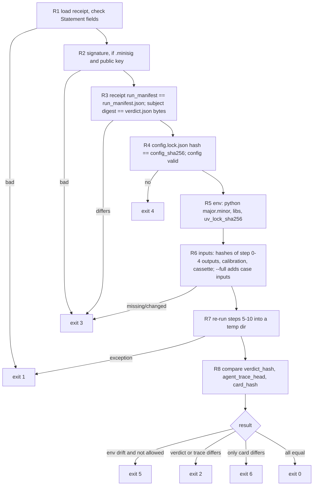

# 10 · Causivra — incident card under a claim checker, verdict receipt, and replay

> Status: v0.1-draft · Lane: Explain · Master: [docs/02-architecture.md §6.10](../02-architecture.md#610-causivra--explanation-and-receipt) (also §2 P3–P4, §4 step 10, §5.2) · Contracts: [docs/03-contracts.md §10, §11, §12](../03-contracts.md#11-causivra-outputs) · Last updated: 2026-10-30

---

## 1. Purpose and scope

Causivra turns a sealed verdict into something a person can read and anyone can re-check:

1. **Card** (`card.json`, `card.md`): title, status, root, candidate set, confidence, timeline, propagation path, evidence table, why-not for runner-ups, asks, next steps from deterministic playbooks ([02 §6.10](../02-architecture.md#610-causivra--explanation-and-receipt)).
2. **Prose under a claim checker**: the LLM writes sentences with placeholders; code fills names and numbers; the checker rejects any sentence with a raw number, an entity outside the enum, or no atom citation. Two failures → template prose. Numeric hallucination is impossible by construction.
3. **Receipt** (`receipt.json`): the run manifest, `verdict_hash`, `card_hash` and the agent-trace head, wrapped as an in-toto Statement v1; optional minisign signature.
4. **Replay** (`veyltrace replay <receipt>`): re-hash, reload the cassette, re-run steps 5–10, compare hashes, exit 0–6.

Causivra never changes the verdict. With `ai.mode = off` it produces the same card structure with template prose ([02 §3.1](../02-architecture.md#31-why-these-boundaries)).

| In scope | Out of scope (owner) |
|---|---|
| card assembly, narration, checker, playbooks, `card.md` | verdict, trials, conformal set (Causentra) |
| receipt assembly, optional signing | `run_manifest.json` (core writes it; Causivra embeds it) |
| replay algorithm and exit codes | the CLI shell and pipeline runner (`veyltrace_core`; replay calls `run_case` from step 5) |

Why: practitioners value evidence pointers more than a proposed root cause and find numeric confidences hard to interpret ([verified_agents §Q6][va-q6], [§Q8][va-q8]); ARGUS writes "Unknown" rather than inferring missing values and computes its confidence label in code ([verified_agents §Q2][va-q2]). A receipt that combines a hash-chained trace and an in-toto envelope is a design inference with no single precedent ([verified_agents §Q7][va-q7]).

## 2. Inputs and outputs

### 2.1 Inputs

| Input | Contract | Used for |
|---|---|---|
| `verdict.json` | [03 §10](../03-contracts.md#10-causentra-output-verdictjson) | everything on the card; `verdict_hash` |
| `evidence.parquet` | [03 §7](../03-contracts.md#7-faultloom-output-evidence--key-candidate-kind-atom_id) | atom values, units, labels |
| `agent_trace.jsonl` | [03 §9.2](../03-contracts.md#92-agent_tracejsonl--one-json-object-per-line) | `agent_trace_head` (last `line_hash`); chain verified before use |
| `run_manifest.json` | [03 §12](../03-contracts.md#12-core-output-run_manifestjson) | embedded in the receipt |
| `case_manifest.json` | [03 §2.1](../03-contracts.md#21-case_manifestjson) | `services` (entity lexicon); never `t_alert_hint_ns` |
| `alert.json` | [03 §2.6](../03-contracts.md#26-alertjson-produced-by-cores-alert-step-pipeline-step-1) | `t_alert_ns`, `protocol`, `clamped` for the timeline |
| `onsets.json`, `changes.parquet`, `graph.paths`, `graph.nodes` | [03 §4.2, §5.2, §6](../03-contracts.md) | timeline, path, `{ONSET}`, entity enum (03 lists Causivra as their consumer; OQ-1 resolved) |
| Narration cassette entries | `cassette/` | `ai.mode = replay` |
| Config | `config/causivra.yaml`, `config/llm.yaml` | §4 |
| Playbooks | `packages/causivra/playbooks/playbooks.yaml` | next steps |
| Prompts | `packages/causivra/prompts/{system,narrate,repair}.md` | narration; hashes join `run_manifest.ai.prompt_sha256` ([08 §3.5](08-relentra.md#35-prompts-and-system-briefs)) |

### 2.2 Outputs

`card.json` ([03 §11.1](../03-contracts.md#111-cardjson)):

| Field | How it is filled |
|---|---|
| `schema_version`, `case_id`, `verdict_hash` | contract writer; copied from verdict |
| `title` | deterministic template by status (§3.1 step 1) |
| `status`, `root`, `confidence` | copied verbatim from verdict |
| `candidate_set` | `[{service, component?}]` copied from `verdict.candidate_set`; empty for `NO_FAULT` |
| `summary` | `[{text, cites}]`: filled LLM sentences or template sentences (§3.2, §3.5) |
| `timeline` | `[{t_ns, label, cites}]` sorted by (`t_ns`, `label`) |
| `path` | `graph.paths.nodes` of the root at `path_rank = 1`; `[]` when `root` is null |
| `evidence_table` | `[{atom_id, label, value, unit?}]` sorted by (`candidate`, `kind`, `atom_id`) |
| `why_not` | `[{service, text, cites}]` for `ranked[1 … why_not.max]` |
| `asks` | `[{text}]` from `verdict.asks` |
| `next_steps` | `[{text, playbook_id}]` (§3.6) |
| `narrator` | `{path: llm \| template, model?, attempts, checker_failures}`: `attempts` = LLM narration calls made (0–2); `checker_failures` = sentences rejected across attempts |
| `card_hash` | SHA-256 of `canonical_json(card without card_hash)` (same rule as `verdict_hash`; [03 §11.1](../03-contracts.md#111-cardjson)) |

`card.md`: Markdown rendered only from `card.json` (§3.7). `receipt.json`: in-toto Statement v1 exactly as [03 §11.2](../03-contracts.md#112-receiptjson-in-toto-statement-v1). Optional `receipt.json.minisig` (file name not in 02 §4.1 → OQ-3).

Run-dir sequencing ([02 §6.10](../02-architecture.md#610-causivra--explanation-and-receipt), [03 §12](../03-contracts.md#12-core-output-run_manifestjson)): step 10 is split. **10a** Causivra writes `card.json` and `card.md`; core then writes `config.lock.json` and `run_manifest.json` (its `outputs` list every artifact except `run_manifest.json` and `receipt.json`, so they include the card files); **10b** Causivra writes `receipt.json`.

## 3. Algorithm

### 3.1 Card assembly (deterministic part)

1. **Title** by status:

   | Status | Title |
   |---|---|
   | `CONFIRMED`, `LIKELY` | `<STATUS> · <root.service> · <root.fault_class>` |
   | `INCONCLUSIVE`, root present | `INCONCLUSIVE · leading candidate <root.service>` |
   | `INCONCLUSIVE`, root null | `INCONCLUSIVE · no single root cause` |
   | `NO_FAULT` | `NO_FAULT · no fault detected in the incident window` |

2. Copy `status`, `root`, `confidence`, `candidate_set`.
3. **Evidence table.** Atom set A = atoms of every trial of `ranked[0]` (or of `ranked[0…2]` when `root` is null) ∪ `claim_check` atoms on that candidate with `holds = true`; capped at `card.evidence_max`, keeping atoms referenced by trials first. `label` comes from `labels.<kind>` templates filled from `candidate` and `args_json` (e.g. `internal_anomaly` → "`<candidate>` `<signal>` anomaly (`<window>`)").
4. **Timeline.** Entries: alert (`alert.t_alert_ns`, label `alert (<protocol>)`), incident onset (`onsets.t_onset_ns`), the root's internal and external onsets (`onsets.per_service`), every change in `changes` on a decision-pool candidate (`verdict.ranked`) with `t_ns` inside `alert.windows` (decoys included: the card shows them, the verdict weighs them). `cites` = atoms of kind `onset_precedence` or `change_proximity` whose `args_json` names that entry; may be empty for the alert line.
5. **Path** as in §2.2.
6. **Why-not.** Empty for `NO_FAULT` (there is no root to compare against). Otherwise, for each runner-up, the first failing trial in ID order picks the template (e.g. `T2` → "{SVC:x} started after its dependents (failed T2, precedence)."); if no trial failed: "{SVC:x} passed the mandatory trials but its verified score was lower." `cites` = that trial's atoms, else the runner-up's first atom in the table.
7. **Asks.** `verdict.asks` rendered by `asks.<kind>` templates: "`<kind>`: `<target>` — `<why>`".
8. **Next steps** (§3.6). 9. **Summary** (§3.2 or §3.5). 10. `narrator`. 11. `card_hash`. 12. `card.md`.

All template strings in steps 1–8 are trusted code text, filled by the same filler as LLM prose (§3.3).

### 3.2 LLM narration (`ai.mode = record | replay`)

1. Build the narration input: status, confidence level, set size, root and runner-up as placeholders, trial results of the root (IDs and pass/fail/untestable), path as placeholders, and the evidence table as rows `atom_id | label | kind | unit`. **Values are not shown**; the model must write `{E<id>.value}`. This removes the main source of copied digits (a design choice; the effect on rejection rate is measured in §9).
2. Schema (flat, per case):

   ```json
   {"type": "object", "additionalProperties": false, "required": ["sentences"],
    "properties": {"sentences": {"type": "array", "minItems": 2, "maxItems": "<narration.max_sentences>",
      "items": {"type": "object", "additionalProperties": false, "required": ["text", "cites"],
        "properties": {"text": {"type": "string", "maxLength": 300},
                       "cites": {"type": "array", "minItems": 1, "maxItems": 4,
                                 "items": {"enum": "<evidence_table atom_ids>"}}}}}}}
   ```

3. **Attempt 1** via `veyltrace_llm.call_json(purpose="causivra.narrate", …)`; sampler and seed rules as Relentra ([08 §3.8](08-relentra.md#38-model-runtime-and-sampler)) with seed purpose `causivra.seed/<seed_index>`.
4. Run the checker (§3.4) on every sentence. If any sentence fails, **attempt 2** = same messages + output + `repair.md` listing `(sentence index, rule ID, offending token)`.
5. If attempt 2 also has a failing sentence, or a provider error occurs at any point: discard all LLM sentences and use template prose (§3.5); `narrator.path = template`.
6. Otherwise fill placeholders (§3.3) → `summary`. `narrator = {path: llm, model: <name>, attempts, checker_failures}`.

Why-not, asks and next steps stay template-only in v0.1 (`narration.scope = summary`), to keep the call small on CPU.

### 3.3 Placeholder grammar

```ebnf
placeholder = "{" , ref , "}" ;
ref         = atom_ref | role_ref | svc_ref ;
atom_ref    = "E" , 10 * hex , "." , atom_field ;          (* hex = 0-9 a-f, lowercase *)
atom_field  = "value" | "unit" | "label" | "candidate" | "window" ;
role_ref    = "ROOT" , [ "." , root_field ]
            | "RUNNER_UP" , [ "." , ru_field ]
            | "CONF." , conf_field
            | "STATUS"
            | "ONSET" ;
root_field  = "component" | "fault_class" | "indicator" | "mode" ;
ru_field    = "fault_class" | "indicator" ;
conf_field  = "level" | "set_size" | "margin" ;
svc_ref     = "SVC:" , node ;                               (* node: exact graph.nodes.node, case-sensitive *)
```

| Placeholder | Resolves to | Valid when |
|---|---|---|
| `{E….value}` | atom `value`, formatted (below) | atom in `evidence_table` and in the sentence's `cites` |
| `{E….unit}` | atom `unit`, or `""` | same |
| `{E….label}` / `.candidate` / `.window` | table label / atom candidate / atom window | same |
| `{ROOT}`, `{ROOT.<field>}` | `verdict.root.service` / field (`component` falls back to service) | `root` not null |
| `{RUNNER_UP}`, `{RUNNER_UP.<field>}` | `verdict.ranked[1]` | `len(ranked) ≥ 2` |
| `{CONF.level}` / `{CONF.set_size}` / `{CONF.margin}` | `confidence.level` / integer / margin, 2 decimals | always |
| `{STATUS}` | `verdict.status` | always |
| `{ONSET}` | `onsets.t_onset_ns` as `HH:MM:SS UTC` | `onsets.json` present |
| `{SVC:<node>}` | `<node>` | `<node>` ∈ `graph.nodes.node` |

Number formatting (one function, `Decimal` with `ROUND_HALF_EVEN`): 3 significant figures; plain notation for 0.001 ≤ |x| < 10⁶, otherwise `.3g`; integers below 10⁶ unchanged; `null`/NaN → `n/a`. Units are printed exactly as stored.

### 3.4 Claim checker

Applied to the raw LLM sentence (before filling) in this order; the first failing rule is reported. Rules C4–C6 consider only text **outside** placeholders.

| Rule | Rejects when | Config |
|---|---|---|
| C1 syntax | a `{…}` does not match the grammar, or braces are unbalanced | — |
| C2 resolvable | a placeholder fails its "valid when" condition (§3.3), e.g. `{ROOT}` under `NO_FAULT` | — |
| C3 citation | `cites` empty, a cite not in `evidence_table`, or an atom placeholder whose atom is not in `cites` | — |
| C4 raw digits | any `[0-9]` except inside an allowed whole token | `checker.allowed_digit_tokens` = `T1`…`T10`, `p50`, `p90`, `p95`, `p99`, `4xx`, `5xx`, `k8s`, `HTTP/2` |
| C5 quantities | `%`, or a quantity word | `checker.quantity_words` = two … twenty, twice, thrice, double(d), triple(d), quadrupled, half, halved, tenfold, dozen, hundred(s), thousand(s), million(s), percent, percentage |
| C6 entities | a token equal (case-insensitive) to a node, a `case_manifest.services` entry or an evidence `component`; or an identifier-shaped token (`[a-z0-9]+([-_][a-z0-9]+)+`, or lower→upper camel case) not in the allow-list | `checker.allowed_compound_words` = end-to-end, runner-up, follow-up, self-time, change-induced, low-confidence, medium-confidence, high-confidence, real-time, in-flight, gRPC |
| C7 status honesty | a certainty word when `status` ≠ `CONFIRMED` | `checker.certainty_words` = confirmed, certainly, definitely, proven, undoubtedly, "the root cause is" |
| C8 shape | > 300 chars or > 40 words before filling; more than one sentence terminator; not ending in `.` | `checker.max_chars`, `checker.max_words` |

C6 forces every entity through `{SVC:…}`/`{ROOT}`, so "entity outside the enum" becomes impossible to render. It will reject plain words that happen to be service names (OTel Demo uses `cart`, `payment`, `shipping`); the false-rejection rate is measured (§9) and the rule stays strict by default (a priori). The template sentences of §3.5 must pass the checker; a test enforces it.

### 3.5 Template prose (fallback, and `ai.mode = off`)

Same grammar, same filler. The atom chosen for `{E*}` below is the first atom of the named kind on the root in `evidence_table` order; if none exists the sentence is skipped.

| Status | Sentences |
|---|---|
| `CONFIRMED` | "{ROOT} is the only member of the candidate set and passed every mandatory trial." (cites: root trial atoms) · "Its strongest internal signal was {E*.label} at {E*.value} {E*.unit}." (`internal_anomaly`) · "Confidence is {CONF.level}; its verified score leads {RUNNER_UP} by a relative margin of {CONF.margin}." |
| `LIKELY` | "{ROOT} is the most likely root cause; the candidate set has {CONF.set_size} services." · strongest-signal sentence · margin sentence |
| `INCONCLUSIVE` | "No single root cause could be established; the candidate set has {CONF.set_size} services." · "The leading candidate is {ROOT}." (root present) · "The asks below list the telemetry or trials that would settle it." |
| `NO_FAULT` | "No anomaly above threshold was found at the entry service or inside any service." · "The candidate set is empty and no root cause is named." |

Template sentences may have empty `cites` only when no citable atom exists (for example a `NO_FAULT` case with no atoms); LLM sentences never may.

### 3.6 Deterministic playbooks

Selection: `NO_FAULT` → `PB-NOFAULT-01`; `INCONCLUSIVE` → `PB-INCONC-01`; `CONFIRMED`/`LIKELY` → the playbook for `root.fault_class`, then `PB-CHANGE-01` if `root.mode = change` or the root passed T6. Steps keep file order. Steps are read-only diagnostics or "consider … after review"; v1.0 never acts on the cluster ([02 §11](../02-architecture.md#11-out-of-scope-for-v10-do-not-build)).

| `playbook_id` | Trigger | Steps (abridged) |
|---|---|---|
| `PB-CPU-01` | `cpu` | compare CPU use with the limit and check throttling on {ROOT}; compare replicas; look for a deploy, config or traffic change; consider scaling out or raising the limit after review |
| `PB-MEM-01` | `mem` | compare memory with the limit; check restarts and OOM-kill events; look for steady growth (leak); consider restart or rollback after review |
| `PB-DISK-01` | `disk` | check I/O latency and volume usage on {ROOT.component}; check node disk pressure; look for noisy neighbours |
| `PB-DELAY-01` | `delay` | compare caller-observed and callee-side latency on edges of {ROOT} (edge gap); check network policy and node networking; check DNS |
| `PB-LOSS-01` | `loss` | check connection errors, resets and retries on {ROOT}; check CNI and node interface health; review retry and timeout settings |
| `PB-ERROR-01` | `error` | inspect error-level log templates new in the incident on {ROOT}; break errors down by operation and status code; check restarts and readiness |
| `PB-EXC-01` | `exception` | inspect exception records and stack traces on {ROOT}; map them to the code path; check the latest code deploy |
| `PB-CONFIG-01` | `config` | diff the latest config or flag change on {ROOT} against the previous version; consider reverting after review |
| `PB-DEP-01` | `dependency` | check the datastore or cache used by {ROOT}: latency, connections, locks; compare callers of the dependency |
| `PB-UNK-01` | `unknown` | review the evidence table; collect the telemetry listed under asks |
| `PB-CHANGE-01` | change mode or T6 pass | identify the change that preceded onset on the timeline; compare with peers or the previous version; consider rollback after review |
| `PB-INCONC-01` | `INCONCLUSIVE` | collect the telemetry named in asks; inspect each candidate-set member; re-run the diagnosis |
| `PB-NOFAULT-01` | `NO_FAULT` | confirm with the alert source whether the alert was spurious; check SLO thresholds; check for silent services or telemetry gaps |

The full step texts live in `playbooks.yaml`; they contain no digits and use only `{ROOT}`/`{ROOT.component}`.

### 3.7 `card.md`

Rendered from `card.json` only: title; status banner with `confidence.level`, set size and margin (never a probability); summary; candidate set, written as "empty" for `NO_FAULT` and for an empty set; Markdown evidence table; timeline as `HH:MM:SS UTC — label`; path joined with `→`; why-not; asks; next steps with playbook IDs; narrator line ("prose: template" or "prose: LLM <model>, checked"); footer with `verdict_hash`, `card_hash` and the replay command. No timestamps of rendering time.

### 3.8 Receipt assembly

1. Read `run_manifest.json` (written by core after 10a) and check it lists `verdict.json`, `card.json`, `card.md` in `outputs`.
2. `subject[0]` = `{name: "verdict.json", digest: {sha256: SHA-256(file bytes of verdict.json)}}`. Note this differs from `verdict_hash` (canonical JSON without the hash field); both are checked on replay.
3. Verify the `agent_trace` chain; `agent_trace_head` = last `line_hash`, or `null` when there is no trace (`ai off`, or `status = skipped`).
4. `predicate` = `{run_manifest, verdict_hash, card_hash, agent_trace_head}`; Statement `_type` and `predicateType` exactly as 03 §11.2.
5. Write `receipt.json` as `canonical_json` bytes.
6. Optional signing (`signing.enabled`): sign the `receipt.json` bytes with a minisign-compatible Ed25519 key whose secret-key path comes from the environment variable `VEYLTRACE_MINISIGN_SECRET_KEY` (never from the repo); write `receipt.json.minisig`. The signature file is outside every hash. Tool or library choice is an ADR at X-09.

### 3.9 Replay

`veyltrace replay <receipt.json> [--run-dir DIR] [--full] [--allow-env-drift] [--report PATH] [--keep]`. Core's CLI parses arguments and calls `veyltrace_causivra.replay.replay(...)`.



Steps:

1. **R1** Parse `receipt.json`; require `_type`, `subject[0].name = "verdict.json"`, `predicateType = https://veyltrace.dev/rca-verdict/v1`. Unreadable or malformed → 1.
2. **R2** If `receipt.json.minisig` exists and `signing.public_key_path` is configured, verify; failure → 3. Signature present but no public key → warning.
3. **R3** Run dir = receipt's directory unless `--run-dir`. The receipt's embedded `run_manifest` must equal `run_manifest.json` on disk (canonical bytes), and SHA-256 of `verdict.json` must equal `subject[0].digest.sha256`; else → 3.
4. **R4** Load the run dir's `config.lock.json` (the fully resolved config, [02 §4.1](../02-architecture.md#41-run-directory)) through core's loader; invalid or hash ≠ `config_sha256` → 4. Replay never reads the repo's current `config/<engine>.yaml` files.
5. **R5** Environment: compare `env.python` (major.minor), every `env.libs` version and `uv_lock_sha256`; `env.os` and `code.commit` are reported but never fail (a receipt from a Windows laptop must replay on CI Linux, [verified_agents §Q3][va-q3] Tier 1). Drift is recorded; it decides the exit code only at the end.
6. **R6** Inputs: recompute SHA-256 of every `run_manifest.outputs` entry produced by pipeline steps 0–4 (`case_manifest.json`, `telemetry/*`, `alert.json`, `signal_cube/*`, `anomalies.parquet`, `onsets.json`, `alignment.json`, `changes.parquet`, `graph/*`), the calibration file under `config/calibration/` (`calibration_sha256`) and, when `ai.mode ≠ off`, the cassette (`cassette_sha256`, [08 §5.2](08-relentra.md#52-cassette-veyltrace_llm)). These files are read, not regenerated, so their bytes must match exactly; missing or changed → 3. With `--full`, also `case_manifest.inputs` against the dataset location, and steps 0–4 are re-run too; a regenerated Parquet file that differs while pyarrow differs from `env.libs` is environment drift (→ 5), not a mismatch ([03 §1](../03-contracts.md#1-how-contracts-work), "Parquet hashes").
7. **R7** Re-run steps 5–10a (no receipt) via `veyltrace_core.pipeline.run_case(from_step=5, ai_mode=…, out=<temp dir>)`, with `ai_mode = off` if the original was `off`, else `replay`. A `CassetteMiss` raised by Relentra or the claim pass marks the verdict "not reproducible" (→ 2). A `CassetteMiss` in narration falls through to template prose and shows up as a card difference (→ 6 if the verdict matched). Any other exception → 1.
8. **R8** Compare the recomputed `verdict_hash` and `agent_trace_head` with the receipt, then `card_hash`. To help diagnosis, also compare `evidence.parquet`, `slate.json` and `proposals.json` hashes and report the first divergent artifact.
9. **R9** Exit code = first match in this precedence: 1 → 4 → 3 → 5 (drift found and `--allow-env-drift` not given) → 2 → 6 → 0.

| Exit | Meaning ([02 §6.10](../02-architecture.md#610-causivra--explanation-and-receipt)) | Raised by |
|---|---|---|
| 0 | ok: verdict, trace head and card reproduced | R9 |
| 1 | error: malformed receipt, unexpected exception | R1, R7 |
| 2 | verdict hash mismatch (also: agent-trace head mismatch, or Relentra cassette miss) | R7, R8 |
| 3 | inputs missing or changed (incl. signature, embedded manifest, cassette, calibration) | R2, R3, R6 |
| 4 | invalid config, or config hash differs | R4 |
| 5 | environment drift (python, libs, `uv.lock`) | R5 |
| 6 | narrative mismatch only: verdict and trace reproduced, card differs | R8 |

**Narrative-only mismatch.** Exit 6 is a pass for the decision and a fail for the explanation. The report lists differing card fields and separates `summary` (LLM prose) from deterministic fields (title, table, playbooks), since a deterministic-field difference means template or playbook code changed.

**Report.** Canonical JSON to stdout and to `--report`: `{exit_code, checks: [{id, ok, detail}], env_drift: [...], first_divergence?, verdict_hash: {expected, actual}, card_hash: {expected, actual}, agent_trace_head: {expected, actual}}`. The gateway serves it as the `replay_report` API type ([03 §14](../03-contracts.md#14-api-types-gateway), [06](../06-gateway-and-console.md)). The temp dir is deleted unless `--keep`.

### 3.10 Claim-grounding metrics (evaluation)

Computed by code from cards; no judge ([verified_agents §Q8][va-q8]).

| Metric | Definition | Expected |
|---|---|---|
| Citation coverage | sentences with ≥ 1 cite / sentences | 100% on the LLM path by construction |
| Numeric fidelity | numbers in filled text that came from placeholders / all numbers in filled text (re-scan against the fill log) | 100% by construction |
| Entity–atom consistency | sentences where every mentioned entity is the candidate of ≥ 1 cited atom / sentences | measured |
| Checker rejection rate | rejected sentences / generated sentences, per rule C1–C8 | measured |
| Fallback rate | cards with `narrator.path = template` under `ai record` | measured |
| Path grounding | Node F1 and Edge F1 of `card.path` vs labelled propagation paths (lab cases with paths) | measured |
| Human rubric | Correctness, Evidence Backing, Actionability (fully/partially/not met), 2 raters, 20–30 cards, LLM vs template; Cohen's κ and Gwet's AC1 (ARGUS reported κ 0.36 vs AC1 0.81 on skewed ratings) | measured |

## 4. Configuration — `config/causivra.yaml`

| Key | Default | Unit | Rationale |
|---|---|---|---|
| `narration.enabled` | `true` | bool | `false` → template prose even with AI on |
| `narration.scope` | `summary` | enum | §3.2; `all` would also narrate why-not |
| `narration.max_sentences` | 5 | sentences | a priori |
| `narration.max_attempts` | 2 | calls | 02: "two failures → template" |
| `narration.max_tokens` | 300 | tokens | a priori; CPU cost (§8) |
| `narration.budget_ms` | 60,000 | ms (recorded latency) | [02 §9](../02-architecture.md#9-cross-cutting-rules) (*target*) |
| `narration.show_values` | `false` | bool | §3.2; ablation |
| `card.evidence_max` | 20 | atoms | a priori |
| `why_not.max` | 3 | services | a priori |
| `checker.max_chars` / `checker.max_words` | 300 / 40 | chars / words | a priori |
| `checker.allowed_digit_tokens` | §3.4 | list | a priori |
| `checker.quantity_words` | §3.4 | list | a priori |
| `checker.allowed_compound_words` | §3.4 | list | a priori |
| `checker.certainty_words` | §3.4 | list | a priori |
| `labels.<kind>` | one template per evidence kind | text | display |
| `asks.<kind>` | one template per ask kind | text | display |
| `format.sig_digits` | 3 | digits | a priori |
| `signing.enabled` | `false` | bool | demo only |
| `signing.public_key_path` | `null` | path | public key may be committed; secret key never |
| `replay.compare_intermediates` | `true` | bool | diagnostics in the report |

## 5. Determinism, recording and isolation

1. Every deterministic part (title, table, timeline, path, why-not, asks, playbooks, templates, `card.md`, receipt) is a pure function of the run artifacts and config; lists are sorted as stated in §2.2; no clock reads.
2. LLM narration goes through `veyltrace_llm` with the cassette ([08 §5.2](08-relentra.md#52-cassette-veyltrace_llm)); seeds come from `veyltrace_core.rng(case_id, "causivra.seed/<i>")`. Narration calls are recorded in the cassette only, not in `agent_trace.jsonl`, whose producer is Relentra (03 §9.2).
3. `card.json` and `receipt.json` are written with `canonical_json`; `card_hash` and the receipt are therefore stable across machines.
4. minisign signatures may embed a timestamp in the trusted comment; that is why the signature file sits outside every hash.
5. Causivra imports `veyltrace_llm` (allowed, [02 §9](../02-architecture.md#9-cross-cutting-rules)); it never imports an HTTP client directly and never writes to any verdict input.

## 6. Failure behaviour

| Condition | Action | Card result |
|---|---|---|
| Model down or timeout (record) | template prose; error recorded in cassette | `narrator.path = template`, `attempts` = calls made |
| Invalid JSON from the model | counts as a failed attempt | retry once, then template |
| Checker rejects (attempt 2) | template prose | `checker_failures` counts rejected sentences |
| Narration budget exceeded | stop, template prose | as above |
| Cassette miss in narration (replay) | template prose | card differs → replay exit 6 |
| `onsets.json`/`changes` missing | timeline holds the alert only; `{ONSET}` invalid (C2) | card still valid |
| No path for root | `path = []` | — |
| Broken `agent_trace` chain | refuse to write the receipt; pipeline error | replay of that run would exit 3 |
| `run_manifest.json` missing card outputs | refuse to write the receipt | pipeline error (core sequencing bug) |
| Signing key missing while enabled | receipt written unsigned; warning | — |

## 7. Tests

| Kind | Cases |
|---|---|
| Unit | placeholder parser (grammar accept/reject table); resolver for every placeholder incl. null root; number formatter (property test: deterministic, never scientific in the plain range); each checker rule with accept and reject examples; playbook selection per status and fault class; `card_hash` stability; `card.md` rendering |
| Seeded bad sentences (adversarial) | "Latency rose to 512 ms." (C4) · "CPU doubled on {ROOT}." (C5) · "The fault is in paymentservice-v2." (C6) · "frontend errors grew." with `frontend` a node (C6) · sentence without cites (C3) · cite not in the table (C3) · `{ROOT}` under `NO_FAULT` (C2) · "The root cause is confirmed." under `INCONCLUSIVE` (C7) · two sentences in one item (C8) · `{E0000000000.value}` unknown atom (C2/C3). Each must be rejected with the stated rule; acceptance of X-09 |
| Template safety | every template sentence passes the checker on `synth-01…05` (property test over verdict fixtures) |
| Golden | `synth-01…05` cards with `ai off` from Causentra's verdict fixtures → `packages/causivra/fixtures/synth-0N/{card.json,card.md}`; FakeProvider narration scripted for one valid and one twice-rejected case |
| Receipt | in-toto field check; round trip; `subject` digest equals file hash; tamper `verdict.json` → R3 fails |
| Replay | one fixture per exit code: 0 clean; 1 truncated receipt; 2 a monkeypatched Causentra scoring function (simulates code drift with identical inputs and config); 3 deleted `signal_cube/series.parquet`; 4 edited `config.lock.json` in a copied run dir; 5 manifest recorded with a different lib version; 6 a monkeypatched playbook text (card changes, verdict does not). Runs in `tests/integration/test_explain_replay.py` |
| Determinism | two runs on `synth-01` give identical `card.json`, `card.md`, `receipt.json` bytes |

## 8. Performance budget

| Item | Budget |
|---|---|
| Deterministic card + receipt | < 1 s per case (*estimate*; small JSON and one Parquet read) |
| Narration call | prompt ≈ 1,500 tokens, output ≤ 300 tokens (*estimates*); wall ≈ 1,500 / pp + 300 / tg; at the sourced 6.1–6.5 tok/s decode, output alone ≈ 50 s ([verified_agents §Q4][va-q4]); cap `narration.budget_ms` = 60 s (02 §9 *target*) |
| Replay | time of steps 5–10 with no LLM latency (cassette), i.e. within the deterministic-path budget of ≤ 30 s per RE2 case ([02 §9](../02-architecture.md#9-cross-cutting-rules)) plus hashing |

## 9. Evaluation hooks and ablations

- LLM narration vs template (`narration.enabled`), scored with §3.10 and the human rubric.
- `narration.show_values` true vs false: effect on rejection rate (C4) and fallback rate.
- Checker rule ablation (C5, C6, C7 off) on recorded narration outputs: how many sentences each rule catches; false-rejection rate of C6 by system (OB vs OTel Demo naming).
- Model 9B vs 4B narration (cost, fallback rate).
- Replay fidelity: share of recorded runs with exit 0 (M3 target: 100% verdict reproduction) and the share with exit 6.

## 10. Tasks and milestones

| ID | Scope here | Milestone |
|---|---|---|
| X-00 | stub: schema-valid template card, receipt skeleton | M0, 3 Nov |
| X-03 | template card + deterministic playbooks + `card.md`; golden cards on synth verdict fixtures | M1, 8 Nov |
| X-09 | LLM narration + placeholders + checker + template fallback; receipt (in-toto); `veyltrace replay` exit codes | M3, 22 Nov — acceptance: replay passes on recorded runs; checker rejects the seeded bad sentences |
| X-13 | paper section on narration and the grounding metrics | M4, 29 Nov |

Replay is on the never-cut list ([07 §1.1](../07-roadmap.md#11-cut-list-if-a-milestone-slips-by--1-day)).

## 11. Open questions

| # | Question | Default |
|---|---|---|
| OQ-1 | ~~CCR: Causivra as a consumer of `onsets`, `changes`, `graph.*`~~ | Resolved in 03 §1 catalog (2026-10-30) |
| OQ-2 | ~~CCR: how `card_hash` is computed~~ | Resolved in 03 §11.1 (2026-10-30): SHA-256 of canonical card JSON without `card_hash` |
| OQ-3 | `receipt.json.minisig` is not in the 02 §4.1 run-dir listing | Optional file, outside `run_manifest.outputs` (written after the manifest) |
| OQ-4 | ~~Step 10 ordering and `run_manifest.outputs` scope~~ | Resolved in 02 §6.10 and 03 §12 (2026-10-30): 10a card → core writes `config.lock.json` + `run_manifest.json` → 10b receipt; `outputs` excludes `run_manifest.json` and `receipt.json` |
| OQ-5 | ~~Replay needs the exact config~~ | Resolved in 02 §4.1 and 03 §12 (2026-10-30): core writes `config.lock.json` into the run dir; `config_sha256` is its hash |
| OQ-6 | ~~CCR: no `replay_report` contract~~ | Resolved in 03 §14 (2026-10-30): `replay_report` is a gateway API type generated from the gateway's OpenAPI; fields as in §3.9 |
| OQ-7 | ~~What replay re-hashes by default~~ | Resolved in 02 §6.10 (2026-10-30): default re-hashes step 0–4 outputs, `config.lock.json`, calibration and cassette and re-runs 5–10; `--full` re-hashes raw inputs and re-runs 0–10 |
| OQ-8 | ~~Which env fields trigger exit 5~~ | Resolved in 02 §6.10 and 03 §12 (2026-10-30): Python major.minor, `libs`, `uv_lock_sha256`; `os` reported only. `code.commit` is also only reported (this spec) |
| OQ-9 | Agent-trace head mismatch has no own exit code | Exit 2 (the recorded provenance did not reproduce) |
| OQ-10 | C6 strictness on systems whose service names are common words | Strict; revisit after the first OTel Demo cards if C6 false rejections exceed 30% of sentences |
| OQ-11 | ~~CCR: `card.json` has no `candidate_set`~~ | Resolved in 03 §11.1 (2026-10-30): optional `candidate_set` copied from the verdict |

## 12. References

- Master spec [02 §6.10](../02-architecture.md#610-causivra--explanation-and-receipt), [§5.2](../02-architecture.md#52-ai-modes), [§4.1](../02-architecture.md#41-run-directory); contracts [03 §10–12](../03-contracts.md#11-causivra-outputs); [08-relentra](08-relentra.md) for the cassette and sampler.
- [verified_agents §Q2][va-q2] grounding rules, computed confidence · [§Q3][va-q3] replay tiers · [§Q4][va-q4] CPU speed · [§Q6][va-q6] set-plus-reason confidence display · [§Q7][va-q7] in-toto Statement v1, hash chains, PROV · [§Q8][va-q8] explanation metrics, rubric, κ/AC1.

[va-q2]: ../../research_notes/Veyltrace%20v2%20SOTA%20root%20cause%20analysis/verified_agents_local_llms.md#q2-verification-and-guarding-patterns-what-evidence-shows-they-improve-accuracy-or-trust
[va-q3]: ../../research_notes/Veyltrace%20v2%20SOTA%20root%20cause%20analysis/verified_agents_local_llms.md#q3-determinism-and-replay-with-llms-what-is-achievable-on-cpu-vs-gpu
[va-q4]: ../../research_notes/Veyltrace%20v2%20SOTA%20root%20cause%20analysis/verified_agents_local_llms.md#q4-local-open-weight-models-for-a-16-gb-laptop-tool-use-json-speed-ram-licences
[va-q6]: ../../research_notes/Veyltrace%20v2%20SOTA%20root%20cause%20analysis/verified_agents_local_llms.md#q6-calibration-and-abstention-for-rca--aiops
[va-q7]: ../../research_notes/Veyltrace%20v2%20SOTA%20root%20cause%20analysis/verified_agents_local_llms.md#q7-provenance-and-receipts-recording-evidence-lineage-so-verdicts-can-be-audited
[va-q8]: ../../research_notes/Veyltrace%20v2%20SOTA%20root%20cause%20analysis/verified_agents_local_llms.md#q8-evaluating-explanations-how-papers-measure-the-faithfulness-and-usefulness-of-rca-explanations
